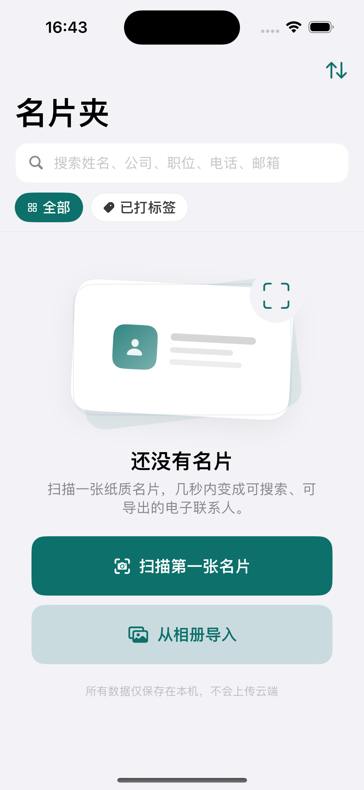
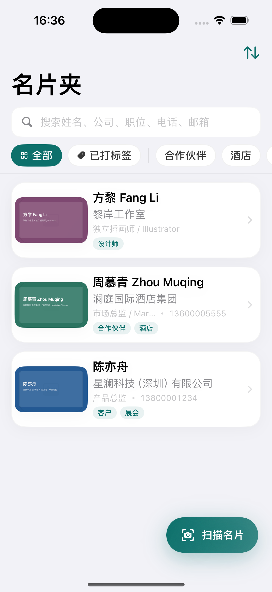
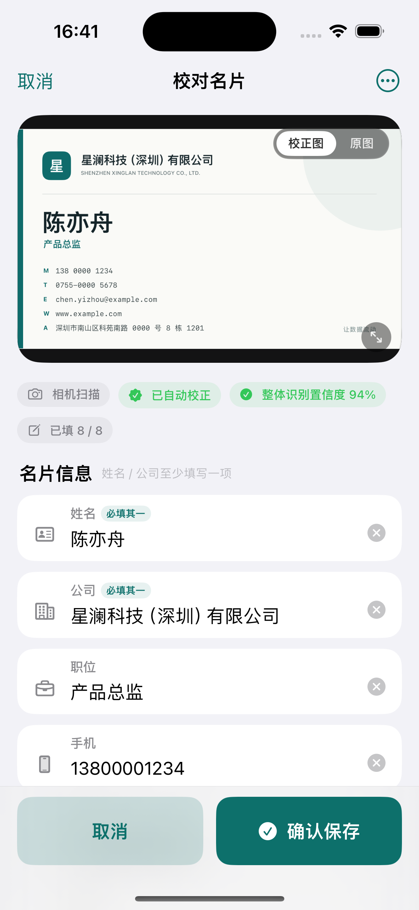
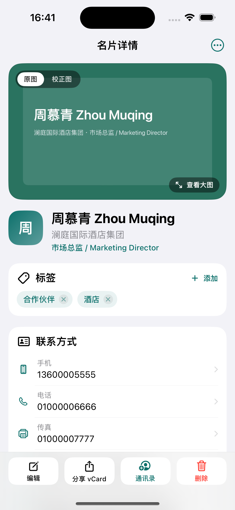

# 名片全能王（CamCard Clone）

> GitHub 仓库：https://github.com/LZK-OMA/camcard-blackbox-replica

> 项目报告：`Reports/名片全能王复刻报告.pdf`

一个完全离线的 iOS 17+ 名片扫描与管理工作流，使用 SwiftUI + SwiftData + Vision 实现。无第三方依赖、无网络请求。

## 端到端闭环

```
名片夹（搜索 / 标签 / 空态）
  → AVFoundation 相机预览拍摄 / PhotosPicker 相册选图
  → 名片区域检测 + 透视校正 + Vision OCR
  → BusinessCardFieldParser 字段抽取
  → 人工校对页 Human-in-the-Loop（8 字段可编辑 / 清空 / 二次确认）
  → 图片写入沙盒 + SwiftData 持久化
  → 名片夹自动刷新
  → 详情页（电话 / 邮件 / Safari / 标签 / 备注 / 删除 / vCard / 通讯录）
```

## 目录结构

| 路径 | 作用 |
| --- | --- |
| `Source/Views/CardListView.swift` | 名片夹首页：搜索、标签筛选、排序、空态、卡片列表、扫描悬浮入口 |
| `Source/Views/CameraCaptureView.swift` | AVFoundation 实时取景、相机权限引导、闪光灯、拍摄、重拍、相册切换 |
| `Source/Views/CardScannerView.swift` | 扫描流程协调器：相机/相册取图、流水线进度、自动 push 校对页 |
| `Source/Views/CardCorrectionView.swift` | **核心考点**：人工校对 8 字段、置信度提示、重复检测、图片落盘保存 |
| `Source/Views/CardDetailView.swift` | 详情：原图/校正图、全部字段、标签增删、备注编辑、系统联动、导出、删除 |
| `Source/Views/Components/` | 缩略图异步加载、流式标签布局、全屏缩放预览、分享面板、Toast、字段行 |
| `Source/ViewModels/` | 五个页面的 MVVM ViewModel（含 `CameraCaptureViewModel`） |
| `Source/Services/CameraCaptureService.swift` | AVCaptureSession 配置/启停、单张拍照、闪光灯能力检测 |
| `Source/Services/CardScanPipeline.swift` | Vision 文本识别 + 矩形检测 + `CIPerspectiveCorrection` + 解析器桥接 |
| `Source/Services/SampleCardFactory.swift` | 模拟拍摄的示例名片图（TC01）与 OCR 原文 |
| `Source/Services/CardStore.swift` | 应用级数据源：图片与 SwiftData 的事务边界、标签/备注/删除 |
| `Source/Services/ContactExporter.swift` | vCard 3.0 生成（75 字节折行、vCard 转义）+ 临时 `.vcf` + Contacts 写入 |
| `Source/Services/CardRepository.swift` | 既有仓库：搜索、标签筛选、排序、持久化 |
| `Source/Services/CardImageFileManager.swift` | 既有图片文件仓库：只保存相对路径 |
| `Source/Models/BusinessCard.swift` | 既有 SwiftData 实体 |
| `Source/CamCardCore/` | 既有纯本地字段解析器（测试通过） |
| `Source/App/` | `@main` 入口、依赖容器、根视图、Info.plist 权限模板 |
| `Source/Preview/` | Mock 数据与 Xcode Preview 入口 |

## 关键设计

### Human-in-the-Loop
- 校对页同时服务「扫描新建」与「详情编辑」。
- 姓名 / 公司至少一个非空；保存按钮保持可用，但校验失败只展示行内错误，不写库。
- 新建时若手机号或「姓名 + 公司」重复，先弹出二次确认，确认后才保存。
- 空字段提交时写为 `nil`，由 `BusinessCard.sanitize()` 统一清洗。
- 保存流程：原图/校正图先写入 `Documents/Cards/<uuid>/`，再写 SwiftData；任一步失败会清理已写图片。

### 相机拍摄（功能二）
- `CameraCaptureView` 使用 `AVCaptureVideoPreviewLayer` 实时取景，背面广角相机、会话预设 `.photo`。
- `CameraCaptureService` 在专用串行队列上配置/启停 session，并处理照片输出；主线程只负责 UI 状态。
- `CameraCaptureViewModel` 管理权限状态机：
  - 未决定 → 系统权限弹窗；
  - 已授权 → 启动预览；
  - 已拒绝 → 友好说明 + 「去设置」+「从相册导入」+「使用示例名片」；
  - 无摄像头（模拟器）→ 直接降级到相册/示例名片，不弹无意义的权限框。
- 支持闪光灯自动/开/关、拍摄、拍后「重拍 / 使用照片」、任意状态切换系统相册。
- 拍摄或选图完成后，`CardScannerView` 统一驱动 `CardScanPipeline`，再 push `CardCorrectionView`。
- 真机首次使用前必须配置 `NSCameraUsageDescription`。

### OCR 与区域校正
- `VNDetectRectanglesRequest` 取最大矩形，`CIPerspectiveCorrection` 校正；检测失败自动降级为原图。
- `VNRecognizeTextRequest` 使用 `.accurate` + `zh-Hans`/`en-US`，按阅读顺序合并文本行。
- 所有重型图像处理在 `Task.detached` 中执行，主线程只推进状态。
- 模拟器没有摄像头时，可使用 TC01 示例名片走同一条校对/保存链路；示例字段仍由同一个 `BusinessCardFieldParser` 解析。

### 数据与刷新
- `CardStore` 是唯一写入入口，每次写操作后递增 `revision`。
- 名片夹监听 `revision` 自动刷新，扫描页关闭后也会 reload。
- 列表/详情图片通过 `ImageIO` 降采样并 `NSCache`，避免大图反复解码。

### 系统联动
- 电话 → `tel://`
- 邮箱 → `mailto:`
- 网址 → Safari (`openURL`)
- 分享 → `.vcf` 写入 `tmp/Exports/`，通过 `UIActivityViewController` 分享
- 导出联系人 → `CNContactStore`（需要 `NSContactsUsageDescription`）

## 目录总览

| 目录 | 内容 |
| --- | --- |
| `Source/App/` `Source/Models/` `Source/Services/` `Source/ViewModels/` `Source/Views/` `Source/Common/` `Source/` `Source/Preview/` `Source/Diagnostics/` | 源码与工程（Xcode / SwiftPM 构建路径） |
| `Fixtures/` | 30 张评测图片、OCR 夹具、评测结果与指标 |
| `Scripts/` | 图片生成、评测、图表、报告转换脚本 |
| `Reports/` | 项目报告（md/pdf）、AccuracyReport、图表、spec.md、prompt.txt |
| `Assets/` | UI Golden 截图、演示视频 |

## 集成说明

1. 将 `Source/App/`、`Source/Common/`、`Source/Models/`、`Source/Services/`、`Source/Views/`、`Source/ViewModels/`、`Source/Preview/` 加入 iOS App Target。
2. 将 `Source/CamCardCore` 加入同一个 Target，或把本地 SwiftPM 包 `CamCardCore` 链接进 App。解析器 API 已声明为 `public`，两种方式均可编译。
3. 在 Target 的 Info 中补充权限：
   - **`NSCameraUsageDescription`（必须）**：相机预览与拍摄。
   - `NSContactsUsageDescription`：用于「导出到联系人」。
   - `NSPhotoLibraryUsageDescription`（可选）：本实现使用 PhotosPicker，通常无需完整相册权限。
   - 仓库已提供 `Source/App/Info.plist` 模板，可直接作为 Target 的 Info.plist，或把上述键合并进现有 Info.plist。
4. 最低部署版本 iOS 17.0。App 不需要网络权限或定位权限。

## 验证

- 既有解析器测试：`swift test --disable-sandbox` → 12/12 通过。
- 全量 iOS 源码在 `-strict-concurrency=complete` 下类型检查通过（使用 `swiftc -typecheck`，未运行 `xcodebuild`）。
- 数据链路端到端自检（示例图 → 图片落盘 → SwiftData 保存 → 搜索/标签/备注 → vCard → 编辑 → 删除）全部通过。
- 相机取景、权限弹窗、闪光灯与真实拍摄需要在真机验证；模拟器会自动进入「无可用相机」降级页，仍可用相册或示例名片走通后续流程。

## 截图

| 名片夹空态 | 名片夹列表 |
| --- | --- |
|  |  |

| 人工校对 | 名片详情 |
| --- | --- |
|  |  |

> 相机页需要真机取景，未附模拟器截图；模拟器会显示「当前设备没有可用相机」并提供相册 / 示例名片入口。
