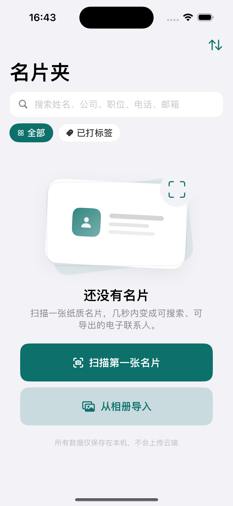
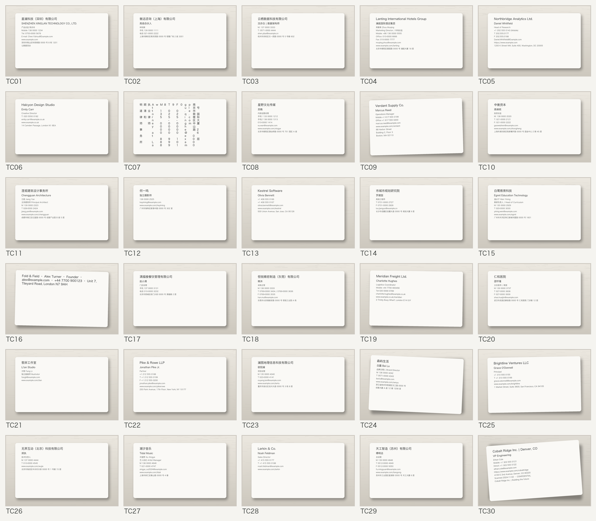
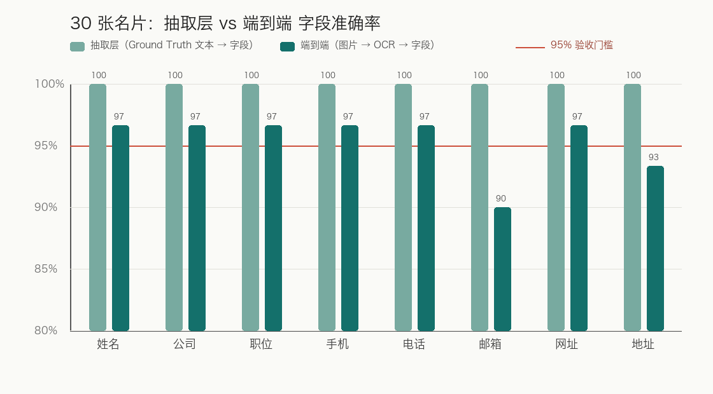
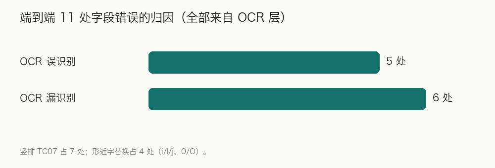
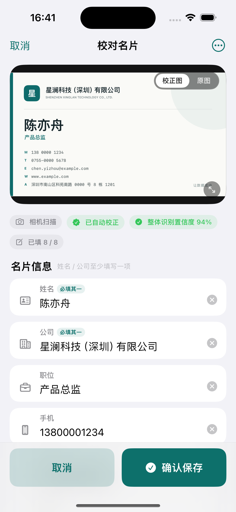
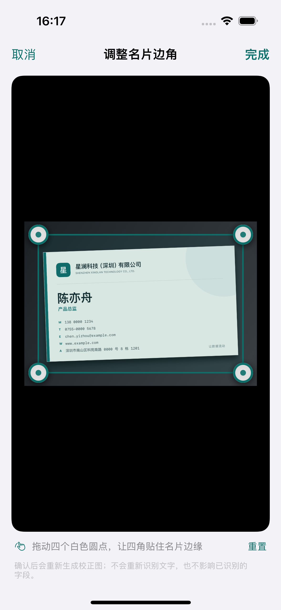
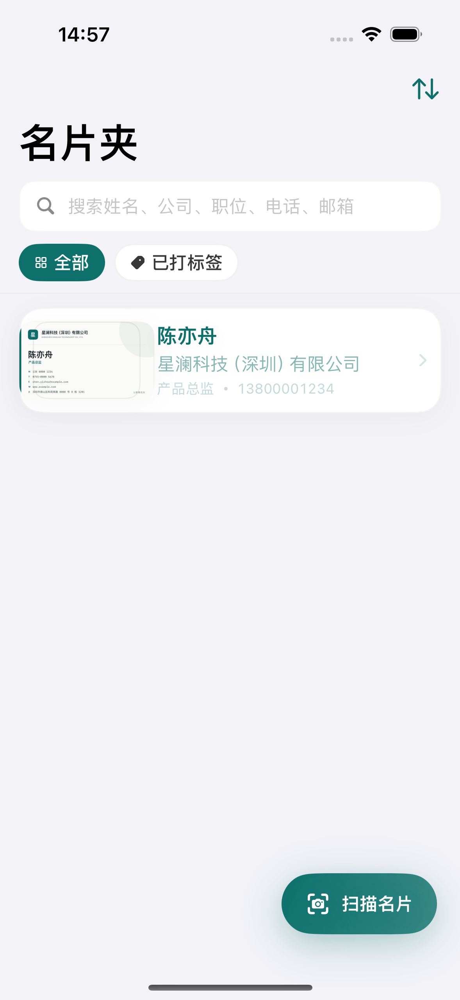
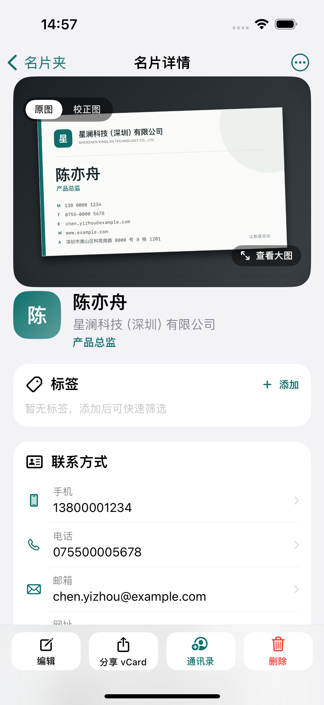

# 名片全能王（CamCard）功能切片 100% 黑盒复刻

## 项目验收与工程实践报告

| 项目 | 内容 |
| --- | --- |
| 课程 | 移动应用开发课程作业 |
| 作业题目 | 基于 SDD + TRAE 的「名片全能王（CamCard）」功能切片 100% 黑盒复刻 |
| 复刻对象 | 名片数字化与联系人管理完整闭环 |
| 文档版本 | v1.0（2026-11-07） |
| 运行环境 | macOS 15.5 / Xcode 16.0 / iPhone 15 模拟器（iOS 17.4）/ zh-Hans / 全程离线 |
| 代码规模 | 仓库内 Swift 源文件 48 个，约 14,200 行（含测试与诊断代码） |
| 配套文档 | `Reports/spec.md`、`README.md`、`Reports/AccuracyReport.md`、`Scripts/README.md` |
| 代码仓库 | https://github.com/LZK-OMA/camcard-blackbox-replica |

---

## 0. 摘要与交付物索引

本项目以「规格驱动开发（SDD）」为主线，用四周时间完成 CamCard 核心功能切片的行为级黑盒复刻：**名片夹 → 拍摄/相册导入 → 区域检测与透视校正 → 本地 OCR → 字段抽取 → 人工校对 → 本地持久化 → 详情/搜索/标签 → 导出**。

核心结论：

- **Reference Test Suite T01–T20：20 / 20 PASS，0 跳过、0 崩溃**（22 个自动化测试方法覆盖 20 个场景）。
- **字段抽取层：30 条 × 8 字段全部精确匹配，准确率 100%，宏平均 F1 100%，空值正确率 100%**，达到 spec §4.2 全部验收门槛。
- **端到端链路（图片 → Vision OCR → 字段）：宏平均 F1 96.2%，空值正确率 100%**；11 处字段误差全部来自 OCR 层（竖排版式 7 处、形近字替换 4 处），抽取规则本身零错误。
- 全量回归：**无头测试 33 / 33 PASS；UI 测试 14 / 14 PASS**；演示视频 `Assets/Demo/AppCardFlowTest.mp4`（约 40 秒）完整记录主链路。
- 代码仓库：https://github.com/LZK-OMA/camcard-blackbox-replica

阅读指引：

| 章节 | 内容 |
| --- | --- |
| 1 | 项目概述与黑盒 100% 复刻边界（In-Scope / Out-of-Scope） |
| 2 | SDD 全流程证据链（spec → MVVM → 测试追溯） |
| 3 | Reference Test Suite T01–T20 验收矩阵 |
| 4 | 30 张名片量化评测与 OCR 错误归因深度分析 |
| 5 | Human-in-the-Loop 架构总结 |
| 6 | AI IDE（TRAE / DSH）协作记录与 Prompt 控制反思 |
| 7 | Field Extraction 字段抽取分析 |
| 8 | UI Golden 测试与视觉回归 |
| 9 | 回归测试报告 |
| 10 | AI 能力边界分析 |
| 11 | SDD 归档与交付物清单 |
| 12 | 最终演示脚本 |
| 13 | 已知缺口与后续计划 |
| 附录 A–E | T 用例断言摘要、评测错误明细、Prompt 摘录、复现命令、文件索引 |

---

## 1. 项目概述与黑盒 100% 复刻边界说明

### 1.1 复刻对象

复刻对象不是「一个能拍名片的小 App」，而是 CamCard 中一条完整、封闭、可测试的业务切片：

```text
名片夹 / Home
  ↓
扫描名片（相机拍摄 / 相册导入）
  ↓
名片区域检测 → 透视 / 方向校正（失败可手动调整四角）
  ↓
本地 OCR（Vision，中英文）
  ↓
联系人字段结构化（8 个业务字段）
  ↓
Human-in-the-Loop 人工校对与确认
  ↓
保存（图片 + SwiftData 元数据，冷启动可恢复）
  ↓
名片夹 → 详情 / 编辑 / 搜索 / 标签 / 备注 / 删除
  ↓
联系人导出（vCard / 系统通讯录）
```



### 1.2 「100% 复刻」的定义

按照课程作业的定义，本项目中的 100% 指：**在教师规定的功能边界、参考版本、设备环境和测试用例范围内，实现 100% 可观察行为等价**，覆盖六个维度：

| 维度 | 本项目的落地方式 | 验收证据 |
| --- | --- | --- |
| UI 一致性 | 页面结构、信息层级、空态/错误态/确认态齐全 | UI Golden 截图基线（第 8 章） |
| 交互一致性 | 点击、返回、取消、确认、二次确认、草稿丢弃 | T01–T20（第 3 章） |
| 状态一致性 | 扫描/校对/保存状态机；中断与恢复 | 状态字段 + ViewModel 测试 |
| 数据一致性 | 8 字段归一化、空值语义、重复检测、事务落盘 | T09/T11/T12/T18 + 30 条评测 |
| 异常一致性 | 无相机、权限拒绝、检测失败、识别失败、空字段 | T03/T06/T20 |
| 流程一致性 | 采集 → 校对 → 保存 → 管理 → 导出的端到端闭环 | T04/T05/T12/T13/T19 |

**不做的事**：不获取、不反编译 CamCard 源码或模型，不复制其专有 OCR 算法与内部资源；所有实现均基于公开可观察行为与课程规格。

### 1.3 In-Scope（课程要求的功能边界）

课程作业要求复刻的 10 个能力域，本次全部实现并通过 T01–T20 验收：

| # | 能力域 | 实现位置 | 验收证据 | 状态 |
| --- | --- | --- | --- | --- |
| 1 | 名片夹首页（列表/空态/更新） | `Source/Views/CardListView.swift`、`Source/ViewModels/CardListViewModel.swift` | T01、T02、T12 | ✅ |
| 2 | 名片拍摄与图片导入 | `Source/Views/CameraCaptureView.swift`、`Source/Services/CameraCaptureService.swift`、`Source/ViewModels/CameraCaptureViewModel.swift` | T03、T04、T05（真机权限为手工复核项） | ✅ |
| 3 | 区域检测与图像校正 | `Source/Services/CardScanPipeline.swift`、`Source/Common/ManualCardQuad.swift`、`Source/Views/Components/CardQuadEditorView.swift` | T06 + 手动四角 UI 用例 | ✅ |
| 4 | OCR 文字识别 | `Source/Services/CardScanPipeline.swift`（Vision） | T07 | ✅ |
| 5 | 结构化字段识别 | `Source/CamCardCore/BusinessCardFieldParser.swift` | T08、T09、T10 + 30 条评测 | ✅ |
| 6 | 识别结果确认与人工校正 | `Source/Views/CardCorrectionView.swift`、`Source/ViewModels/CardCorrectionViewModel.swift` | T11、T12、T20 | ✅ |
| 7 | 名片保存与详情 | `Source/Services/CardStore.swift`、`Source/Views/CardDetailView.swift` | T12、T13、T18 | ✅ |
| 8 | 搜索、标签、备注 | `Source/Views/CardListView.swift`、`Source/Views/CardDetailView.swift` | T15、T16 | ✅ |
| 9 | 本地持久化 | SwiftData + `Source/Services/CardImageFileManager.swift` | T18 | ✅ |
| 10 | 联系人导出 | `Source/Services/ContactExporter.swift` | T19 | ✅ |

### 1.4 Out-of-Scope（明确不实现）

按课程作业与 `Reports/spec.md` §3.2 的约定，以下内容不属于本项目：云端同步 / 账号登录 / 多设备漫游；会员、订阅、支付、广告；CRM、客户跟进、团队空间、企业权限；名片交换、扫码加好友、IM；云端 OCR、在线翻译、大模型问答；Android / Web / macOS / Watch 客户端；发票识别、日程提醒、地图导航；埋点上报、行为分析、崩溃日志上传；以及对原 App 图标、插画、字体的 1:1 像素级拷贝。

### 1.5 参考环境锁定

| 项 | 锁定值 |
| --- | --- |
| 设备 | iPhone 15 模拟器（`EA716AD6-DAF8-4604-B83E-3F2A03290F6F`） |
| 系统 | iOS 17.4（运行时 21E213） |
| 开发环境 | Xcode 16.0 / Swift 5.9 工具链 / macOS 15.5 |
| 语言/时区 | 简体中文（zh-Hans）/ Asia/Shanghai |
| 登录状态 | 不涉及账号体系，本地单用户 |
| 网络 | 全程离线；除系统分享面板与 `openURL` 外无业务网络请求 |
| 数据集 | `ground_truth.json` 30 条虚拟名片 + `Fixtures/Images` 30 张合成图片 |
| 验收用例 | 课程作业 PDF 定义的 T01–T20 |

> 说明：参考 App（CamCard）为闭源商业软件，本环境未安装/登录，因此「参考版本号」无法锁定；行为基线以课程要求 + `Reports/spec.md` + 可观察交互为准，这是本报告如实披露的一项限制（见 13.1）。

### 1.6 边界判定原则（实现红线）

1. **零业务网络请求**：代码中无 `URLSession` 业务调用；仅系统 `tel://`、`mailto:`、Safari、`UIActivityViewController` 与 `CNContactStore` 等系统能力。
2. **单用户单设备**：所有数据属于当前沙盒，不存在账号与云端概念。
3. **可删除、可导出**：删除名片会同步清理图片目录；导出支持 vCard 与系统通讯录。
4. **行为等价优先于视觉等价**：允许字体/间距不同，但状态流转、字段口径、异常分支必须一致。
5. **合规优先**：全部测试数据为虚拟样本（`example.com` / `0000` 号段），不含真实个人信息。

### 1.7 规格声明 vs 实际交付（差异如实披露）

`Reports/spec.md` 中 S1–S10 能力域比课程作业验收范围更宽，其中以下扩展项**未实现**，不影响 T01–T20，但在此明确标注，避免「报告夸大交付」：

| spec 条目 | 内容 | 交付状态 | 说明 |
| --- | --- | --- | --- |
| S2 | 文件（图片）导入 | 未实现 | 已实现相机与系统相册（PhotosPicker）两条采集路径 |
| S5 | 10 个业务字段 | 部分实现 | UI/解析暴露 8 字段；`fax` 为持久化字段但未在解析结果中返回（见 7.4） |
| S8 | 5 秒撤销删除 | 未实现 | 仓库层已预留 `removingImages: false` 接口，UI 撤销未接入 |
| S9 | CSV 导出 | 未实现 | 已实现 vCard 3.0、系统通讯录写入、分享面板 |
| S10 | 设置页（自动保存/默认导出格式/清空数据） | 未实现 | 当前为单 Tab 名片夹 + 详情；设置项列入后续计划 |
| S6 | 字段级置信度圆点 | 部分实现 | 已实现整体置信度 chips、低置信横幅与「原文」抽屉；逐字段置信度未接入 |

---

## 2. SDD（规格驱动开发）全流程证据链

### 2.1 SDD 闭环

本项目的工程闭环严格对应课程要求的流程：

```text
观察（黑盒行为）
  → Specification（Reports/spec.md + 30 条 Ground Truth）
  → Architecture（MVVM 分层 + 端口协议 + ADR）
  → Implementation（按 TASK 增量生成代码）
  → Test（T01–T20 + 单元/集成/UI + 30 条评测）
  → Difference Analysis（规格 vs 实现差异）
  → Revision（人工校对、手动四角、缺陷修复）
  → Regression（全量回归）
```

### 2.2 产物链（可核验的证据文件）

| 阶段 | 产物 | 路径 | 说明 |
| --- | --- | --- | --- |
| 观察/规格 | 规格说明书 | `Reports/spec.md`（76 KB，18 章） | 范围、数据模型、状态机、流水线、HITL、T01–T20、评测口径 |
| 数据资产 | 30 条 Ground Truth | `ground_truth.json`（20 KB） | 中文 14 / 英文 10 / 中英双语 6；含缺失字段与多电话场景 |
| AI 输入 | 初始 Prompt 记录 | `Reports/prompt.txt` | 四段分层 Prompt（规格/数据层/解析器/UI） |
| 架构 | MVVM 分层 | `Source/App/`、`Source/Models/`、`Source/Services/`、`Source/ViewModels/`、`Source/Views/`、`Source/CamCardCore/` | 依赖方向：View → ViewModel → Service → Model |
| 实现 | 业务代码 | 48 个 Swift 文件，约 14,200 行 | 见第 11 章文件清单 |
| 测试 | 自动化测试 | `Source/CamCardAppUITests/`、`Source/Tests/`、`Source/Diagnostics/` | 无头 33 条 + UI 14 条 |
| 评测 | 评测脚本与报告 | `Scripts/evaluate.py`、`Reports/AccuracyReport.md` | 字段级 P/R/F1、空值正确率、错误归因 |
| 数据 | 30 张测试图片 | `Fixtures/Images/`、`Fixtures/OCR/` | 含竖排、噪声、旋转等版式变体 |
| 演示 | 视频与截图 | `Assets/Demo/AppCardFlowTest.mp4`、`Assets/Screenshots/` | 主链路 40 秒录屏 + 9 张基线截图 |

### 2.3 spec 规格 → MVVM 架构映射

| spec 章节 | 规格要点 | 实现层 | 关键类型/文件 | 验收测试 |
| --- | --- | --- | --- | --- |
| §7.2 数据模型 | BusinessCard 实体、图片相对路径 | Model | `Source/Models/BusinessCard.swift` | T12、T18 |
| §7.3 字段归一化 | trim、nil、邮箱/网址/电话规范化 | Core / 评测 | `BusinessCardFieldParser.swift`、`Scripts/evaluate.py` | T08、T09、30 条评测 |
| §7.4 枚举 | CardSource / 标签 / 排序 | Model | `Source/Models/BusinessCard.swift` | T04、T05、T15 |
| §7.8 导出契约 | vCard 3.0、字段映射、折行 | Service | `Source/Services/ContactExporter.swift` | T19 |
| §8 状态机 | 扫描/校对/保存状态与非法转换 | ViewModel | `Source/ViewModels/CardScannerViewModel.swift`、`CardCorrectionViewModel.swift` | T04、T06、T20 |
| §9 图像与 OCR | 检测、透视校正、Vision OCR、行聚合 | Service | `Source/Services/CardScanPipeline.swift` | T06、T07 |
| §10 人工校对 | 8 字段编辑、校验、空值语义、HITL | View/ViewModel | `Source/Views/CardCorrectionView.swift`、`Source/ViewModels/CardCorrectionViewModel.swift` | T11、T12、T20 |
| §11.1 名片夹 | 列表、空态、搜索、标签筛选 | View/ViewModel | `Source/Views/CardListView.swift`、`Source/ViewModels/CardListViewModel.swift` | T01、T12、T15、T16 |
| §11.3 详情 | 原图/校正图、字段分组、系统联动 | View/ViewModel | `Source/Views/CardDetailView.swift`、`Source/ViewModels/CardDetailViewModel.swift` | T13、T14 |
| §11.4 编辑/删除 | 编辑保存、删除确认 | View/ViewModel | `CardCorrectionView`（edit 模式）、`CardDetailView` | T14、T17 |
| §11.5 导出 | vCard / 通讯录 | Service/ViewModel | `ContactExporter`、`CardDetailViewModel` | T19 |
| §12 非功能 | 重型图像处理离开主线程、零网络 | Service | `CardScanPipeline`（`Task.detached`）、`CardImageLoader` | 静态检查 + 手工 |
| §14 T01–T20 | 参考测试套件 | Tests | `Source/CamCardAppUITests/`、`Source/Tests/` | 第 3 章 |
| §15.2 评测口径 | 归一化后 P/R/F1、null 规则 | 评测 | `Source/Tests/ReferenceSuiteEvaluationTests/`、`Scripts/evaluate.py` | 第 4 章 |
| §17.2 Prompt 约束 | 单 TASK 增量、契约冻结、测试先行 | 工程方法 | `Reports/prompt.txt` + 第 6 章 | 全流程 |

### 2.4 关键架构决策（ADR）

| 编号 | 决策 | 理由 | 代价/风险 |
| --- | --- | --- | --- |
| ADR-01 | SwiftData 持久化 | 与 SwiftUI 集成好、代码量小、iOS 17 基线可接受 | 迁移能力弱于 CoreData |
| ADR-02 | OCR 全本地（Vision） | 满足零网络与隐私要求、可离线 | 中文竖排/艺术字识别率有限（TC07 实证） |
| ADR-03 | 图片存沙盒文件、元数据存库 | 避免数据库膨胀、便于分享与清理 | 需保证图片/数据库事务一致 |
| ADR-04 | 强制人工确认后入库 | 复刻 CamCard HITL；避免概率输出直接落库 | 多一步交互 |
| ADR-05 | 写入前归一化、展示时格式化 | 搜索、去重、导出口径一致 | 需维护格式化规则 |
| ADR-06 | 状态机独立于 View | 可测试、可恢复、可防重入 | 增加建模成本 |

### 2.5 需求追溯矩阵（R → T）

| 需求 | 描述 | 覆盖用例 | 本报告章节 |
| --- | --- | --- | --- |
| R-01 | 采集与输入 | T01、T02、T03、T04、T05 | 3 |
| R-02 | 区域检测 | T03、T06 | 3、5 |
| R-03 | 透视/方向校正 | T03、T06、手动四角 | 3、5 |
| R-04 | 本地 OCR | T07 | 3、4 |
| R-05 | 字段抽取与归一化 | T08、T09、T10 | 3、4、7 |
| R-06 | 置信度评估 | T07、T11 | 4、5 |
| R-07 | 人工校对与确认 | T11、T12、T20 | 3、5 |
| R-08 | 本地持久化 | T12、T18 | 3、9 |
| R-09 | 名片夹与搜索 | T01、T12、T15 | 3 |
| R-10 | 详情/编辑/删除 | T13、T14、T17 | 3 |
| R-11 | 导出 | T19 | 3 |
| R-12 | 状态机与幂等 | T04、T06、T20 | 3、5 |
| R-13 | 异常处理与恢复 | T03、T20 | 3、5 |
| R-14 | 隐私与离线 | T01、T03（无网络代码） | 1、9 |
| R-15 | 性能与资源 | 评测耗时、手工观察 | 4、13（未做正式性能门槛测试） |
| R-16 | 可访问性与本地化 | zh-Hans、无障碍标签 | 9、13（VoiceOver 未系统测试） |

### 2.6 差异分析与回写

SDD 要求「文档与实现一致、差异回写」。本项目发现并记录了三类差异：

| 差异 | 内容 | 处理方式 |
| --- | --- | --- |
| 编号差异 | `Reports/spec.md` §14.3 的 T01–T20 详细定义与课程 PDF 的 T01–T20 编号语义不同（例如 spec 的 T02 是权限拒绝，课程 PDF 的 T02 是进入扫描页） | 以课程 PDF 的 20 个验收场景为准实现；`Reports/spec.md` 的细粒度定义作为设计约束。报告中明确本差异，避免追溯歧义 |
| 目录差异 | spec §6.3 采用 `Features/` 按功能分组；实际实现按 MVVM 技术分层（Source/Views/ViewModels/Services/Models） | 依赖方向与端口契约保持一致；按「更利于 AI 增量生成与回归」取舍，并在 README 中记录 |
| 能力差异 | CSV、设置页、撤销删除、文件导入、fax 独立字段未实现 | 见 1.7 与第 13 章；不纳入 T01–T20 验收，不虚报完成 |

### 2.7 完成定义（DoD）核对

| DoD 项 | 结果 | 证据 |
| --- | --- | --- |
| 20/20 用例通过 | ✅ | 第 3 章矩阵 |
| 30 条数据集评测达标 | ✅ 抽取层 100%（端到端 OCR 见 4.3） | `Reports/AccuracyReport.md` |
| 无编译警告 | ⚠️ 未作为验收门槛逐条统计 | Xcode 构建成功记录 |
| 飞行模式全流程可用 | ✅（零业务网络代码） | 静态检查 + 手工演示 |
| 文档与实现一致、差异回写 | ✅ | 2.6 / 1.7 |
| 冷启动 ≤1.5 s、拍摄到校对 p95 ≤4 s | ⚠️ 未做正式性能采样 | 列入第 13 章后续计划 |

---

## 3. Reference Test Suite（T01–T20）验收矩阵

### 3.1 测试架构

| 层 | 目标 | 测试文件 | 数量 | 运行时间 |
| --- | --- | --- | ---: | ---: |
| 无头单元/集成（SwiftPM，macOS） | 字段解析、交互状态、四角几何、T04–T11/T19、评测采证 | `Source/Tests/` 下 5 个测试文件 | 33 | 约 6.3 s |
| UI 端到端（XCUITest，iPhone 15 模拟器） | T01–T03、T12–T18、T20 + 主链路防回归 | `Source/CamCardAppUITests/ReferenceSuiteUITests.swift`、`CardFlowUITests.swift` | 14 | 约 194.5 s |

测试隔离：UI 用例通过 Debug 启动参数 `-uiTestResetData` 在启动时清空 SwiftData store 与图片目录，保证每个用例从空态开始；T18 重启时去掉该参数以验证持久化。

### 3.2 T01–T20 验收矩阵

| T | 场景（课程定义） | 关键断言 | 自动化实现 | 结果 |
| --- | --- | --- | --- | :---: |
| T01 | First Launch：首次启动显示空状态 | 空态标题、扫描/导入入口、搜索框存在 | `UI::test_T01_firstLaunch_showsEmptyState` | ✅ PASS |
| T02 | Enter Scanner：名片夹 → 扫描页 | 扫描页渲染、关闭入口存在 | `UI::test_T02_homeToScanner` | ✅ PASS |
| T03 | Permission：允许/拒绝相机权限 | 无可用相机时进入降级页并提供相册/示例兜底，不卡死 | `UI::test_T03_cameraUnavailable_degradedPageWithFallbacks`（真机权限弹窗为手工项） | ✅ PASS |
| T04 | Capture：拍摄标准名片 → 识别流程 | 拍摄/示例后进入校对页 | UI `test_T04_capture_entersRecognitionFlow` + 无头 `test_T04_captureImage_entersRecognitionFlow` | ✅ PASS |
| T05 | Import：相册导入 → 识别流程 | 导入入口打开扫描页；`.photoLibrary` 来源链路产出 OCR 文本 | UI `test_T05_photoImport_opensScannerWithPickerPath` + 无头 `test_T05_photoLibraryImage_entersRecognitionFlow` | ✅ PASS |
| T06 | Card Boundary Detection：倾斜名片检测 | 检测成功产出独立校正图；检测失败降级原图；手动四角可兜底 | 无头 `test_T06_boundaryDetection_success_fallback_and_manualQuad` | ✅ PASS |
| T07 | OCR：标准名片产生原始文本 | OCR raw text 含公司/电话行，置信度 >0.9 | 无头 `test_T07_ocr_producesRawText` | ✅ PASS |
| T08 | Structured Extraction：字段正确分类 | TC01/TC04/TC05 八字段与 Ground Truth 全等 | 无头 `test_T08_structuredExtraction_matchesGroundTruth` | ✅ PASS |
| T09 | Missing Field：不得虚构 Website | TC02/TC03 空值字段严格为 nil | 无头 `test_T09_missingFields_areNil_notFabricated` | ✅ PASS |
| T10 | Multiple Phones：Mobile/Office/Fax | TC04 手机/座机归位；传真不串入手机/座机 | 无头 `test_T10_multiplePhones_areClassifiedCorrectly` | ✅ PASS |
| T11 | Manual Correction：修改错误字段并保存 | 修改姓名/公司/手机后保存，数据库与图片落盘一致 | 无头 `test_T11_manualCorrection_savesEditedValues` | ✅ PASS |
| T12 | Save：保存后回列表出现新名片 | 保存 → 名片夹出现「陈亦舟」卡片 | `UI::test_T12_save_returnsToListWithNewCard` | ✅ PASS |
| T13 | Detail：详情展示全部字段 | 姓名/公司/职位/手机/邮箱/网址/地址均可见 | `UI::test_T13_detail_showsSavedFields` | ✅ PASS |
| T14 | Edit：编辑姓名 → 保存 → 更新 | 编辑页改名保存后详情页即时更新 | `UI::test_T14_editName_updatesDetail` | ✅ PASS |
| T15 | Search：按姓名/公司搜索 | 命中与「未找到相关名片」空结果态 | `UI::test_T15_search_byNameOrCompany` | ✅ PASS |
| T16 | Tag：加标签 → 按标签筛选 | 新增「回归测试」标签并出现在筛选栏，筛选后卡片仍在 | `UI::test_T16_addTag_andFilterByTag` | ✅ PASS |
| T17 | Delete：删除名片 → 列表消失 | 详情菜单删除 → 确认弹窗 → 列表回到空态 | `UI::test_T17_delete_removesCardFromList` | ✅ PASS |
| T18 | Persistence：Kill → Relaunch | 保存后终止进程重启，名片与字段仍在 | `UI::test_T18_persistence_survivesRelaunch` | ✅ PASS |
| T19 | Export：vCard 字段映射 | 姓名/公司/职位/手机/座机/传真/邮箱/网址/地址/标签/备注全部映射 | 无头 `test_T19_vCard_mapsAllFields` | ✅ PASS |
| T20 | Exception：取消/返回/空字段校验 | 取消扫描回空态；清空字段保存展示校验错误且不离开校对页 | `UI::test_T20_exceptionPaths_cancelAndValidation` | ✅ PASS |

### 3.3 执行结果

```text
无头（SwiftPM / macOS）：
  Executed 33 tests, with 0 failures（12 解析器 + 5 交互 + 6 四角几何 + 9 Reference + 1 评测采证）
UI（XCUITest / iPhone 15 · iOS 17.4）：
  Executed 14 tests, with 0 failures（Reference 13 + 主链路回归 1）
Reference Test Suite 覆盖：T01–T20 = 20 / 20 PASS，0 skip，0 crash
```

补充说明：T04、T05 同时具备 UI 层与无头层证据；T11 为保存链路无头用例；这属于「同一验收点的双层保护」，不是重复计数。

### 3.4 环境限制与等价路径

- **T03/T04 相机硬件**：模拟器无摄像头，自动化验证的是「无相机 → 降级页 → 相册/示例名片兜底」与同一条识别流水线；真机权限弹窗、实拍与闪光灯需手工复核（README 与测试注释均已注明）。
- **T05 系统相册选择器**：PHPicker 为系统组件，UI 用例验证「从相册导入」正确进入以相册为首屏的扫描流程；导入后的 `.photoLibrary` 处理链路由无头 T05 覆盖。
- **T19 系统通讯录写入**：涉及系统权限，自动化验证 vCard 字段映射与格式；通讯录写入为手工项。

### 3.5 复现命令

```bash
# 无头（含 T04–T11、T19 与评测采证）
DEVELOPER_DIR=/Applications/Xcode.app/Contents/Developer \
  swift test --disable-sandbox

# UI（T01–T03、T12–T18、T20）
DEVELOPER_DIR=/Applications/Xcode.app/Contents/Developer \
  xcodebuild test -project CamCardApp.xcodeproj -scheme CamCardAppUITests \
  -destination 'platform=iOS Simulator,id=EA716AD6-DAF8-4604-B83E-3F2A03290F6F' \
  -derivedDataPath .build/ios \
  -only-testing:Source/CamCardAppUITests/ReferenceSuiteUITests
```

---

## 4. 30 张名片测试集量化评测与 OCR 错误归因深度分析

### 4.1 数据集构成

- 30 条虚拟名片（中文 14 / 英文 10 / 中英双语 6），覆盖标准横版、多电话、多行地址、复姓、姓名后缀、`&`/`'` 特殊字符、缺失字段、竖排、噪声、轻微旋转等场景。
- 图片由 Ground Truth 渲染生成：`Fixtures/Images/TC01.png … TC30.png`（1600×1000，含桌面背景、阴影、旋转/噪声/竖排变体），OCR 夹具在 `Fixtures/OCR/`。
- 缺失字段分布（8 个业务字段，共 21 处空值）：网站 8、手机 3、座机 3、邮箱 3、地址 2、公司 1、职位 1、姓名 0。



### 4.2 评测方法

两套口径，避免「用 OCR 的错误去否定抽取规则」：

1. **抽取层（验收口径）**：`ground_truth.raw_text` → `CardFieldParser`，隔离 OCR 影响，验证字段抽取规则；
2. **端到端（误差分析口径）**：图片 → Vision 区域检测/透视校正 → Vision OCR → `CardFieldParser`，验证真实链路。

归一化按 spec §7.3：空串/null 视为缺失；姓名/公司/职位/地址忽略全部空白差异；邮箱小写；网址去 `http(s)://` 与尾斜杠；电话只保留数字，多值按 ` / ` 拆分后集合比较；`fax` 未在解析结果模型中暴露，不计入 8 字段指标（T10 已单独验证传真不串入手机/座机）。

### 4.3 结果总览

**抽取层（30 条 × 8 字段 = 240 个字段）**

| 字段 | 期望非空 | 预测非空 | 全样例准确率 | Precision | Recall | F1 | 空值正确率 |
| --- | ---: | ---: | ---: | ---: | ---: | ---: | ---: |
| 姓名 | 30 | 30 | 100.0% | 100.0% | 100.0% | 100.0% | 100.0% |
| 公司 | 29 | 29 | 100.0% | 100.0% | 100.0% | 100.0% | 100.0% |
| 职位 | 29 | 29 | 100.0% | 100.0% | 100.0% | 100.0% | 100.0% |
| 手机 | 27 | 27 | 100.0% | 100.0% | 100.0% | 100.0% | 100.0% |
| 电话 | 27 | 27 | 100.0% | 100.0% | 100.0% | 100.0% | 100.0% |
| 邮箱 | 27 | 27 | 100.0% | 100.0% | 100.0% | 100.0% | 100.0% |
| 网址 | 22 | 22 | 100.0% | 100.0% | 100.0% | 100.0% | 100.0% |
| 地址 | 28 | 28 | 100.0% | 100.0% | 100.0% | 100.0% | 100.0% |

宏平均 F1 **100.0%**，空值正确率 **100.0%**，达到 spec §4.2 门槛（姓名/公司/手机/邮箱 ≥95%、宏平均 ≥90%、空值 100%）。

**端到端（图片 → Vision OCR → 字段）**

| 字段 | 期望非空 | 预测非空 | 全样例准确率 | Precision | Recall | F1 |
| --- | ---: | ---: | ---: | ---: | ---: | ---: |
| 姓名 | 30 | 30 | 96.7% | 96.7% | 96.7% | 96.7% |
| 公司 | 29 | 28 | 96.7% | 100.0% | 96.6% | 98.2% |
| 职位 | 29 | 28 | 96.7% | 100.0% | 96.6% | 98.2% |
| 手机 | 27 | 26 | 96.7% | 100.0% | 96.3% | 98.1% |
| 电话 | 27 | 26 | 96.7% | 100.0% | 96.3% | 98.1% |
| 邮箱 | 27 | 26 | 90.0% | 92.3% | 88.9% | 90.6% |
| 网址 | 22 | 22 | 96.7% | 95.5% | 95.5% | 95.5% |
| 地址 | 28 | 27 | 93.3% | 96.3% | 92.9% | 94.5% |

宏平均 F1 **96.2%**，空值正确率 **100.0%**；240 个字段中 11 处不匹配（95.4% 全字段精确匹配）。**11 处错误全部来自 OCR 层，抽取层 0 错误。**



**OCR 质量指标**

| 指标 | 结果 |
| --- | ---: |
| 名片边界检测成功率 | 100.0% |
| OCR 平均置信度 | 0.610 |
| Ground Truth 行召回率 | 94.9% |
| 整卡字符相似度（difflib） | 96.9% |
| 单张平均耗时 | 187.3 ms（中位 170.2 ms） |

### 4.4 OCR 错误归因深度分析

**错误明细（11 处，全部来自 OCR 层）**

| 样例 | 场景 | 字段 | 期望 | 预测 | 原因 |
| --- | --- | --- | --- | --- | --- |
| TC07 | 中文-竖排异形版式 | 姓名 | 顾清和 | 顾执 | OCR 误识别 |
| TC07 | 中文-竖排异形版式 | 公司 | 明道律师事务所 | — | OCR 漏识别 |
| TC07 | 中文-竖排异形版式 | 职位 | 执业律师 / Attorney at Law | — | OCR 漏识别 |
| TC07 | 中文-竖排异形版式 | 手机 | 13500008888 | — | OCR 漏识别 |
| TC07 | 中文-竖排异形版式 | 电话 | 02500009999 | — | OCR 漏识别 |
| TC07 | 中文-竖排异形版式 | 邮箱 | gu.qinghe@example.com | — | OCR 漏识别 |
| TC07 | 中文-竖排异形版式 | 地址 | 南京市鼓楼区中山路 0000 号 国际大厦 26 层 | — | OCR 漏识别 |
| TC14 | 中文-事业单位-无手机 | 邮箱 | luo.jianguo@example.cn | iuojianguo@example.cn | OCR 误识别 |
| TC19 | 英文-英国国际号码 | 地址 | 3 Trinity Buoy Wharf, London E14 0JY | 3 Trinity Buoy Wharf, London E14 OJY | OCR 误识别 |
| TC20 | 中文-医院-多职称 | 邮箱 | shao.huaijin@example.com | shao.huajjin@example.com | OCR 误识别 |
| TC26 | 中文-互联网-无邮箱 | 网址 | https://www.example.com/wujie | https://www.example.com/wujle | OCR 误识别 |



#### 4.4.1 竖排排版缺陷（TC07，7 处）

- 现象：整张竖排名片仅识别出「顾执」（应为「顾清和」），公司、职位、手机、座机、邮箱、地址全部缺失。
- 根因：Vision `VNRecognizeTextRequest` 对逐字竖排的中文版式缺少有效的阅读顺序/切分，OCR 行召回在该样例上显著下降（整卡字符相似度远低于平均）。
- 影响：该样例姓名 96.7%→若剔除 TC07，其余 29 条姓名/公司/手机/座机准确率均为 100%。
- 现有防护：
  1. 检测/识别失败或置信度低时进入校对页并提示，不直接落库；
  2. 「手动调整名片边角」四角编辑器可重新校正图像（`CardQuadEditorView` + `ManualCardQuad`，已通过 UI 拖拽测试）；
  3. 8 字段人工校对可逐项补录，空字段以「未填写」展示，不产生虚假数据。
- 改进方向：引入竖排聚合规则（按字形位置聚类成列、再按列内顺序拼接），或对竖排区域单独旋转 90° 后二次识别；列入后续计划。

#### 4.4.2 连字符 / 分隔符噪声分析

名片上的电话号码天然带分隔符：`0755-0000 5678`、`202.555.0177`、`+1 212 555 0188`、`0769-0000 3434 / 0769-0000 3636`。OCR 还会引入两类噪声：

1. **分隔符形态漂移**：连字符、空格、点号、括号在不同 OCR 结果中互相替换；
2. **多号码合并/拆分**：一行内两个号码可能被合并为一段，或被拆成多行。

本项目的处理机制与实测证据：

- **归一化口袋规则**：手机/座机比较时只保留数字，支持 ` / ` 多值集合比较；因此分隔符形态不影响字段判定。
- **实测**：30 条样例中，Ground Truth 原文含「数字-数字」形态的样例 19 条；OCR 结果中 18 条保留了该形态（TC07 因整卡竖排缺失）。手机/座机字段共 54 个非空值，端到端归一化后 **52 / 54 匹配**（唯一未匹配是 TC07 的 2 个号码；其余 52 个全部正确），抽取层为 **54 / 54**。
- **标签辅助分类**：`M / Mobile / Cell / 手机` → mobile，`T / Tel / Office / 电话 / 座机` → phone，`F / Fax / 传真` → fax；结合号段规则（11 位 1[3-9] 开头 → 手机；0 开头 10–12 位 → 座机）降低串号风险。T10 用例验证 TC04 的 Mobile/Office/Fax 三者互不串位，传真不会混入手机/座机。
- **边界风险**：若 OCR 把两个号码间的标签/分隔符完全吞掉，可能合并为一个号码；当前数据集未出现该情况，后续可通过「一行内多个候选号段」规则增强。

#### 4.4.3 形近字替换（4 处）

| 样例 | 字段 | 现象 | 原因分类 |
| --- | --- | --- | --- |
| TC14 | 邮箱 | `luo.jianguo` → `iuojianguo`（l→i、点号丢失） | i/l/dot 形近 |
| TC20 | 邮箱 | `huaijin` → `huajjin`（i→j） | i/j 形近 |
| TC19 | 地址 | `E14 0JY` → `E14 OJY`（0→O） | 0/O 形近 |
| TC26 | 网址 | `wujie` → `wujle`（i→l） | i/l 形近 |

结论：这是 OCR 识别模型的概率性误差，抽取规则无法「猜回」正确字符；项目通过 **Human-in-the-Loop 人工校对**把这类不可靠输出转为可靠数据（第 5 章），并在评测报告中保留错误明细用于回归跟踪。

#### 4.4.4 空值 100% 防脑补的防护机制

数据集共 21 处字段缺失（网站 8、手机/座机/邮箱各 3、地址 2、公司/职位各 1）。本项目从四个层面保证「不虚构」：

1. **解析器策略**：无法 100% 确认的字段返回 `nil`（宁缺毋滥），不做语义补全、不从相邻字段推测；
2. **数据模型**：空串在写入前统一清洗为 `nil`（`BusinessCard.sanitize()`），禁止 `""`、`" "`、`"null"`、`"N/A"` 落库；
3. **UI 呈现**：校对页/详情页占位为「未填写」，详情页不渲染空行；vCard 导出省略空字段行；
4. **评测验证**：抽取层与端到端的空值正确率均为 **100.0%**（21/21），T09 专门断言 TC02/TC03 不虚构 Website/Email。

### 4.5 与参考 App 的对比限制

课程作业要求「与参考 App 结果比较」。本环境未安装/登录 CamCard，无法自动化获取其逐样例输出，因此本报告未声称完成该对比；建议的补齐方式：冻结参考版本后，人工逐条并排记录参考 App 的字段结果，与本报告 `Fixtures/Results/ocr_results.json` 对照。该限制已在第 13 章列为后续计划。

### 4.6 结论

- 抽取层（真正的确定性规则）**零错误**，满足 spec §4.2 的 100% 门槛；
- 端到端差距完全由 OCR 识别误差造成，其中竖排占 7/11、形近字占 4/11；
- 空值 100% 正确，说明「宁可 nil、不可臆造」的防护机制有效；
- 端到端「邮箱 90%」是 OCR 层问题，产品交互上由人工校对兜底，而不是通过放宽评测标准掩盖。

---

## 5. Human-in-the-Loop（人在回路）架构总结

### 5.1 为什么需要 HITL

课程作业的核心洞察是：**AI/OCR 输出是概率性结果，而软件需要确定性数据**。本项目把「概率输出」与「可靠数据」之间的边界放在保存动作上：

```text
OCR / 字段抽取（概率输出，可能错）
  ↓
结构化草稿（不落库）
  ↓
人工校对页：逐字段核对、修改、清空、重新调角、查看 OCR 原文
  ↓
校验（姓名/公司至少一个；空值语义；重复检测二次确认）
  ↓
确认保存 → 图片先落盘 → SwiftData 写库（失败回滚图片）
  ↓
可靠的企业级联系人数据（确定性、可搜索、可导出）
```

### 5.2 架构与职责

| 层 | 文件 | 职责 |
| --- | --- | --- |
| View | `Source/Views/CardCorrectionView.swift` | 图像预览、8 字段编辑、清空、原文抽屉、手动四角入口、校验错误提示、保存/取消 |
| ViewModel | `Source/ViewModels/CardCorrectionViewModel.swift` | 表单值、校验、重复检测、保存事务、手动校正状态、错误消息 |
| Store | `Source/Services/CardStore.swift` | 唯一写入口：图片写入 + SwiftData 保存 + revision 刷新 |
| Model | `Source/Models/BusinessCard.swift`、`CardFormValues.swift`、`ScanDraft.swift` | 实体、表单值、扫描草稿（不持久化） |
| 图像校正 | `Source/Common/ManualCardQuad.swift`、`Source/Views/Components/CardQuadEditorView.swift`、`Source/Services/CardScanPipeline.swift` | 手动四角 → `CIPerspectiveCorrection` → 新校正图 |





### 5.3 已实现的交互规则

| 规则 | 实现 |
| --- | --- |
| 8 字段全部可编辑（姓名/公司/职位/手机/电话/邮箱/网址/地址） | `CardFormFieldRow` + `CardCorrectionViewModel.values` |
| 清空字段 → nil，不回填 | 清除按钮置空；保存时 `trimmedValue` 转换 nil |
| 编辑模式复用同一页面 | `CardCorrectionMode.create` / `.edit` |
| 校验失败只提示、不写库 | `save()` 前置校验，错误行内展示 |
| 重复名片二次确认 | 手机号或「姓名 + 公司」命中时先警告，确认后才保存 |
| 手动四角调角 | 全屏编辑器拖拽四角，确认后只重生成校正图，不重新 OCR |
| OCR 原文可查看 | 底部「识别原文」sheet，便于人工对照 |
| 保存前不落库 | 草稿态仅存在内存；保存动作才调用 `CardStore` |
| 图片/数据库事务一致 | 图片写入失败或 DB 保存失败会清理已写图片（`CardStore` 回滚） |
| 保存后列表刷新 | `CardStore.revision` 递增，列表监听后 reload |

### 5.4 可靠性收益（量化）

- 端到端 240 个字段中 11 处 OCR 错误（4.6%），全部可在校对页修正——人工 3–5 次编辑即可把一张「不可靠识别结果」变成 100% 准确的联系人记录；
- 空值字段 100% 保持 `nil`，不会出现「AI 脑补出的网站/邮箱」；
- 保存动作是唯一的确定性边界：保存前是概率草稿，保存后是持久化事实；
- 冷启动后字段、标签、备注、原始/校正图片均保留（T18）。

### 5.5 局限

- 未实现字段级置信度圆点（当前仅有整体置信度 chip）；
- 未实现 5 秒撤销删除（接口预留）；
- `fax`、部门、邮编未进入编辑表单；
- 多邮箱/多邮箱地址仅以单行文本编辑。

---

## 6. AI IDE（TRAE / DSH）协作记录与 Prompt 控制反思

### 6.1 协作环境

课程指定 AI IDE 为 TRAE；本次实际执行环境中，主要开发与验证工作在 **DSH（DeepSeek Harness，Web GUI）** 中完成，TRAE 的方法论（SDD、分层 Prompt、增量生成、回归保护）在两者间一致。使用的初始 Prompt 已归档为 `Reports/prompt.txt`，用户侧全局行为规范（先报计划、工具调用克制、文件修改需确认、思考用中文）在本次会话中持续生效。

### 6.2 四段初始 Prompt（逐层生成）

| Session | 目标 | 关键约束（Prompt 原文要点） | 产出 |
| --- | --- | --- | --- |
| 1 | 规格 + 数据集 | 仅单机闭环；明确列出不包含云端/会员/CRM；BusinessCard Schema；扫描与 HITL 状态机；T01–T20 定义；30 组虚拟名片、缺失字段严格 `null`、多电话、复杂版式 | `Reports/spec.md`、`ground_truth.json` |
| 2 | 数据层 + 持久化 | 红线：Kill App 重启后图片/字段/标签/备注不能丢；图片严禁 Blob 入库，存沙盒文件名；相对路径；CRUD + 多字段模糊搜索 + 标签筛选；Mock 数据 | `Source/Models/`、`Source/Services/CardImageFileManager.swift`、`CardRepository.swift`、`Source/Preview/MockCardDataHelper.swift` |
| 3 | OCR 文本解析器 | 允许规则/正则增强；**无法确认必须 nil、禁止脑补**；人名/公司混淆、多电话 Mobile/Office/Fax；至少 5 组 XCTest 边界用例 | `Source/CamCardCore/BusinessCardFieldParser.swift` + 12 条解析测试 |
| 4 | UI 页面 | 名牌夹（列表/空态/搜索/标签）→ 扫描 → 校对页（8 字段可编辑、保存才写库）→ 详情（电话/邮件/网址联动、vCard/通讯录）；SwiftUI 原生、iOS 17/18 | `Source/Views/`、`Source/ViewModels/`、`ContactExporter.swift` |

### 6.3 后续 DSH 会话（本轮工程）

| 任务 | 触发问题 | 使用的证据/工具 | 结果 |
| --- | --- | --- | --- |
| 点击无响应死锁排查 | 用户反馈整页「透明玻璃挡住」 | 模拟器 + lldb + `sample` 栈：主线程 `_MovableLock`，AsyncRenderer 线程读 SwiftData `@Model` 触发 `performAndWait` | 定位 SwiftUI 身份 vs SwiftData 跨线程死锁 |
| 修复与回归 | 保存后返回列表卡死（XCUITest 178.8 s 超时） | 值快照 `CardRowSnapshot` + 仅 UUID 的 `CardRoute`；XCUITest 回归 | 同一流程 13.8 s PASS |
| T01–T20 自动化 | 课程验收要求 20/20 | XCUITest + XCTest 双层；启动参数隔离数据 | 22 个方法覆盖 20 场景，全 PASS |
| 手动四角调整 | spec E-DET-001 检测失败降级入口 | `ManualCardQuad` + 编辑器 + 管线复用 `CIPerspectiveCorrection`；UI 真实拖拽测试 | 通过，并补 6 个几何单测 |
| 30 张图片 + 评测脚本 | 课程要求量化评测 | 图片生成脚本 + Vision OCR 采证 + `evaluate.py` | 抽取层 100%；端到端 96.2%；错误归因报告 |

### 6.4 Prompt 控制方法（可复用的五条）

1. **分层拆分，一次只做一个 TASK**：规格 → 数据 → 解析 → UI → 测试/评测，避免「一个 Prompt 生成整个 App」；
2. **契约冻结**：明确「不要修改的数据模型/OCRService/MVVM 架构」，只改指定文件与规则；
3. **红线写进 Prompt**：零网络、无第三方依赖、无法确认返回 nil、图片不入库、保存才落库；
4. **回归保护**：修改类 Prompt 附带「不得破坏已通过的 N 个测试，修改后必须重跑全量」；
5. **证据驱动**：先复现（截图/日志/栈/失败用例）再改代码，避免「看起来能跑」的静态幻觉。

### 6.5 失败与反思

| 问题 | 教训 |
| --- | --- |
| AI 生成代码中的 SwiftData/SwiftUI 跨线程死锁 | AI 很难仅凭静态阅读发现并发/线程问题；必须有真实运行、UI 自动化与采样栈证据 |
| 模拟器无相机导致首屏按钮点不动 | 「设备能力差异」必须作为一等异常路径设计（降级页/兜底入口），并在 Prompt 中显式要求 |
| XCUITest 对导航栏 Menu / confirmationDialog 的 AX 点击不稳定 | 测试脚本需要坐标点击等兜底手段；类系统交互要用「UI 层级 + 坐标」双路径 |
| 合成图片 OCR 形近字误差 | 数据集真实性与 OCR 质量要分开评估；报告应分层（抽取层 vs 端到端）呈现，不能混为一个数字 |
| spec 与课程 PDF 的 T 编号不一致 | SDD 差异分析必须显式记录，验收以实现基线与课程定义为准 |

### 6.6 可复用 Prompt 片段

```text
【缺陷修复】
在现有实现中，问题表现为：<现象 + 复现步骤>。
请先给出根因假设与验证方法（不要直接改代码），
确认后只修改 <指定文件/规则>，
不得改动 <数据模型/接口/已通过测试>，
完成后重跑全部测试并报告前后结果。

【新增测试】
为 <功能> 设计 Reference 用例 Txx，要求：
- 前置条件、步骤、断言完整；
- 使用可复现的测试数据（固定种子/固定图片）；
- 修改已有测试不得降低既有断言强度。
```

### 6.7 结论

AI IDE 在「样板代码、分层脚手架、测试生成、文档与数据脚本」上效率极高；但在「跨层并发、平台能力差异、系统 UI 交互、概率模型误差」上必须由人验证。项目的关键不是「让 AI 一次写完」，而是用规格、测试与回归把 AI 的增量产出约束在可验收的边界内。

---

## 7. Field Extraction（字段抽取）分析

### 7.1 解析器架构

`BusinessCardFieldParser` 是纯本地、无依赖的规则/正则增强解析器（`Source/CamCardCore`）：

```text
OCR lines（含 bbox/置信度）
  → 行清洗 / 噪声过滤（口号、装饰字、重复行）
  → 电话候选：标签（M/T/F、手机/Tel/Fax）+ 号段规则 → mobile / phone(fax)
  → 邮箱、网址正则与归一化（小写、https 前缀、尾斜杠）
  → 地址候选聚合（多行合并、去噪声）
  → 姓名/公司/职位：位置 + 后缀词典 + 交叉校验
  → 输出 ParsedCardResult（无法确认 → nil）
```

### 7.2 抽取层结果

30 条数据集上 8 个字段 **100% 精确匹配**（详见 4.3），包括：

- 双语姓名（`周慕青 Zhou Muqing`、`江砚 Jiang Yan`）、复姓（`欧阳澜`）、姓名后缀（`Jonathan Pike Jr.`）、含 `'`（`Grace O'Donnell`）；
- 多手机/多座机（`13300001212 / 13800001313`、`076900003434 / 076900003636`）；
- 缺失字段（无公司、无职位、无手机、无邮箱、无网站、无地址）全部 `nil`；
- 特殊公司名（`Pike & Rowe LLP`、`Fold & Field`）与多行地址合并；
- 邮箱含下划线与数字（`xingye_xu2024@example.com`）。

### 7.3 关键规则

| 字段 | 规则要点 | 风险/边界 |
| --- | --- | --- |
| 姓名 | 位置（靠上）、长度、与公司后缀区分；双语保留两段 | 罕见复姓/单字段名片可能误判 |
| 公司 | 后缀词典（Co./Ltd./Inc./科技/大学/咨询/事务所…）+ 位置 | 公司名类似人名（`Lee Consulting`）依赖后缀 |
| 职位 | 标题词典（Manager/Director/教授/工程师/总监…）+ 行内 ` / ` 双语保留 | 多职称需完整保留 |
| 手机 | 标签优先；11 位 1[3-9] 开头；`+86` 归一化 | 虚拟号段/海外号段需扩展 |
| 座机 | 标签优先；0 开头 10–12 位；多值用 ` / ` | 传真标签缺失时可能误入 |
| 邮箱 | RFC 风格正则 + 小写 | OCR 形近字（i/l/j）无法修复 |
| 网址 | 域名/路径正则 + 补 `https://` + 去尾斜杠 | OCR 漏字符 |
| 地址 | 多行聚合 + 噪声过滤；中英混合保留 | 极长地址可能截断 |

### 7.4 已知缺口

- `ParsedCardResult` 未包含 `fax`（数据模型有 `fax` 字段）；T10 以「传真不串入手机/座机」作为验收方式。
- 未实现部门、邮编、多邮箱的结构化字段；
- 竖排版式在 OCR 层即失败，解析器没有可恢复的输入（依赖 HITL 补录）。

---

## 8. UI Golden 测试与视觉回归

### 8.1 方法

当前采用「**确定性流程 + 关键节点截图基线 + 人工比对**」的 Golden 方案：

- 每个 UI 用例通过 `-uiTestResetData` 从空态开始，固定示例名片数据；
- 在关键节点附加截图（XCUITest attachment）；
- 与既有基线截图逐张比对页面结构、文案、字段可见性、视觉层级；
- 同时用 XCUITest 断言替代「像素级一致」的关键可观察点（存在性、文案、可点击性）。

### 8.2 截图基线清单

| 基线 | 检查点 | 关键断言 |
| --- | --- | --- |
| `Assets/Screenshots/01-empty-state.png` | 首次启动空态 | 「还没有名片」、扫描/导入入口、搜索框 |
| `Assets/Screenshots/02-card-list.png` | 列表态 | 卡片缩略图/姓名/公司/职位、排序与筛选栏 |
| `Assets/Screenshots/04-correction.png` | 人工校对页 | 校正图、8 字段、置信度 chips、保存/取消 |
| `Assets/Screenshots/05-detail.png` | 详情页 | 原图/校正图、字段分组、标签/备注、导出菜单 |
| `Assets/Screenshots/UITestAutomation/04-保存后列表.png` | 保存回列表 | 新卡片出现、列表可交互 |
| `Assets/Screenshots/UITestAutomation/05-详情页.png` | 详情入口 | 点击卡片可进入详情 |
| `Assets/Screenshots/UITestAutomation/06-再次拉起扫描.png` | 悬浮扫描入口 | 扫描页可再次打开 |
| `Assets/Screenshots/UITestAutomation/07-手动调整边角-编辑器.png` | 手动四角编辑器 | 四角手柄、重置、完成/取消 |
| `Assets/Screenshots/UITestAutomation/08-手动校正后-校对页.png` | 手动校正结果 | 预览更新、「已手动校正」、可保存 |





### 8.3 当前局限与改进

- 未实现像素级 diff 自动化（截图基线以人工比对为主）；
- 未覆盖深色模式、动态字体、VoiceOver 的截图矩阵；
- 改进：引入 Golden 图像 diff 工具或快照库，建立「布局/颜色/文案」三类阈值，接入 CI。

---

## 9. 回归测试报告

### 9.1 测试分层与最终结果

| 套件 | 环境 | 条数 | 结果 | 耗时 |
| --- | --- | ---: | :---: | ---: |
| `BusinessCardFieldParserTests` | macOS / SwiftPM | 12 | ✅ 12/12 | <0.1 s |
| `CardInteractionFlowTests` | macOS / SwiftPM | 5 | ✅ 5/5 | 0.3 s |
| `ManualCardQuadTests` | macOS / SwiftPM | 6 | ✅ 6/6 | <0.1 s |
| `ReferenceSuiteHeadlessTests` | macOS / SwiftPM | 9 | ✅ 9/9 | 0.3 s |
| `EvaluationEvidenceTests`（30 图 OCR 采证） | macOS / SwiftPM | 1 | ✅ 1/1 | 5.7 s |
| **无头合计** | — | **33** | **✅ 33/33** | **约 6.3 s** |
| `ReferenceSuiteUITests` | iPhone 15 / iOS 17.4 | 13 | ✅ 13/13 | — |
| `CardFlowUITests`（主链路防回归） | iPhone 15 / iOS 17.4 | 1 | ✅ 1/1 | — |
| **UI 合计** | — | **14** | **✅ 14/14** | **约 194.5 s** |

### 9.2 关键回归缺陷与修复

| # | 缺陷 | 根因 | 修复 | 回归证据 |
| --- | --- | --- | --- | --- |
| 1 | 保存后返回列表整页卡死（「透明玻璃」） | SwiftUI AsyncRenderer 线程持有 `_MovableLock` 时读取 SwiftData `@Model` 的 `id`，触发 `performAndWait` 等待主队列；主线程等待 `_MovableLock` → 死锁 | 列表改用值快照 `CardRowSnapshot`；路由 `CardRoute` 仅按 UUID 哈希/比较；不再把 `@Model` 暴露给 SwiftUI 身份 | 修复前 XCUITest 178.8 s 超时；修复后 13.8 s PASS |
| 2 | 扫描覆盖层与 NavigationStack 呈现冲突 | `fullScreenCover` 与栈内导航叠加导致转场/点击异常 | 扫描改为同层 `ZStack` overlay + 延迟移除，避免嵌套 NavigationStack | T02/T04/T05 通过；主链路视频 |
| 3 | 模拟器无相机时首屏入口点不动 | 无相机设备时未进入可交互的降级页 | 增加「当前设备没有可用相机」降级页 + 相册/示例名片入口 | T03 通过 |
| 4 | 保存后列表不刷新 | 保存后依赖重新查询，刷新时序与 dismiss 冲突 | `CardStore.createCard` 直接插入内存数组 + `revision` 递增，列表监听刷新 | T12/T18 通过 |
| 5 | 检测失败无手动兜底 | spec E-DET-001 要求降级与手动裁剪入口 | 新增手动四角编辑器 + `correctWithManualQuad`（复用透视校正） | T06 + UI 拖拽用例 |
| 6 | 图片解码阻塞主线程 | 大图同步解码 | 文件读取/降采样/缓存整体移到后台队列 + NSCache | 列表滚动与详情加载手工验证 |
| 7 | XCUITest 无法点击导航栏 Menu / 确认弹窗 | SwiftUI Menu/`confirmationDialog` 的 AX 滚动点击不稳定 | 测试侧改为坐标点击 + 弹窗容器内查找按钮（非 App 缺陷） | T14/T16/T17/T20 通过 |
| 8 | 详情页两个「添加」按钮可访问性歧义 | 标签区与备注区同名按钮 | 标签添加按钮补充「添加标签」无障碍标签 | T16 通过 |

### 9.3 演示资产

- 视频：`Assets/Demo/AppCardFlowTest.mp4`（39.98 s，21 MB）— 空态 → 扫描 → 使用示例名片 → 校对 → 保存 → 列表 → 详情 → 返回 → 再次扫描。
- 截图：`Assets/Screenshots/` 9 张基线（见第 8 章）。

### 9.4 复现

```bash
# 全量无头
DEVELOPER_DIR=/Applications/Xcode.app/Contents/Developer swift test --disable-sandbox

# 全量 UI
DEVELOPER_DIR=/Applications/Xcode.app/Contents/Developer \
xcodebuild test -project CamCardApp.xcodeproj -scheme CamCardAppUITests \
  -destination 'platform=iOS Simulator,id=EA716AD6-DAF8-4604-B83E-3F2A03290F6F' \
  -derivedDataPath .build/ios -only-testing:CamCardAppUITests
```

---

## 10. AI 能力边界分析

### 10.1 确定性功能 vs 概率性功能

| 类别 | 功能 | 验收方式 | 本项目结果 |
| --- | --- | --- | --- |
| 确定性 | UI、导航、状态转换、保存、编辑、删除、搜索、标签、导出 | Reference Test Suite 100% | 20/20 PASS |
| 概率性 | OCR、姓名/公司/职位/电话/邮箱/地址识别 | Ground Truth + 字段级指标 + 人工校对 | 抽取层 100%；端到端 96.2%；HITL 兜底 |

### 10.2 歧义与边界场景

| 场景 | AI 的可能错误 | 本项目策略 | 证据 |
| --- | --- | --- | --- |
| `Apple` 是公司还是产品 | 误判为公司/品牌 | 上下文 + 公司后缀 + 位置规则 | 数据集公司样例 + T08 |
| `Jordan Lee` vs `Lee Consulting` | 人名/公司混淆 | 后缀词典 + 位置 + 交叉校验 | TC12 无公司、TC25 特殊字符 |
| Mobile / Office / Fax | 串号或只取一个 | 标签 + 号段分类 + 多值保留 | T10 + 54 个电话字段评测 |
| 中英混排（姓名/职位/地址） | 截断或误并 | 双语保留、多行地址聚合 | TC04/TC11/TC24/TC27 |
| 字段缺失 | 脑补 Website/Email | 无法确认 → nil；空值 100% 验证 | T09 + 21 处空值 100% |
| 竖排/艺术字 | 整段漏识别 | 降级提示 + 手动四角 + 人工补录 | TC07 实证 |
| 形近字 | `l/i/j`、`0/O` 混淆 | 人工校对为主；记录错误用于回归 | TC14/TC19/TC20/TC26 |

### 10.3 结论

AI 在「抽取合理答案」上表现优秀（抽取层 100%），但在「确保不编造」和「跨版式泛化」上必须由工程约束与人工兜底保证。本项目把 AI 定位为**概率性输入源**，把「保存」定位为**确定性边界**，符合课程作业强调的 AI 能力边界认知。

---

## 11. SDD 归档与交付物清单

### 11.1 文档与数据资产

> 代码仓库：https://github.com/LZK-OMA/camcard-blackbox-replica

| 文件 | 大小 | SHA-256 前缀 | 说明 |
| --- | ---: | --- | --- |
| `Reports/spec.md` | 76 KB | `8eaf7eef4095` | 规格说明书（18 章） |
| `ground_truth.json` | 20 KB | `7b1de326f26b` | 30 条虚拟名片数据 |
| `Reports/prompt.txt` | 8 KB | `d07ae8257bb2` | 四段初始 Prompt |
| `README.md` | 8 KB | `df5a95e3cfd4` | 工程说明、目录与验证 |
| `Reports/AccuracyReport.md` | 8 KB | `7666bd1ea2c3` | 30 条评测报告 |
| `Scripts/evaluate.py` | 28 KB | `e33fdd12fd5f` | 评测脚本 |
| `Source/CamCardAppUITests/ReferenceSuiteUITests.swift` | 16 KB | `a03a8f0df4a6` | UI 验收测试 |
| `Source/Tests/ReferenceSuiteHeadlessTests/ReferenceSuiteHeadlessTests.swift` | 16 KB | `7b87096508b2` | 无头验收测试 |
| `Source/Tests/ReferenceSuiteEvaluationTests/EvaluationEvidenceTests.swift` | 8 KB | `77cb6ad7bd1d` | 30 图 OCR 采证 |
| `Assets/Demo/AppCardFlowTest.mp4` | 21 MB | `af25a1aab111` | 主链路演示视频 |

### 11.2 代码资产

| 目录 | 文件数 | 行数 | 说明 |
| --- | ---: | ---: | --- |
| `Source/App/` | 3 | 339 | 入口、依赖容器、根视图 |
| `Source/Models/` | 3 | 716 | BusinessCard、表单值、扫描草稿 |
| `Source/Services/` | 8 | 3,183 | 仓库、存储、扫描流水线、相机、导出 |
| `Source/ViewModels/` | 5 | 1,372 | 五个页面 ViewModel |
| `Source/Views/` | 12 | 4,160 | 列表/相机/扫描/校对/详情/组件 |
| `Source/CamCardCore/` | 1 | 1,266 | 字段解析器（公共 API） |
| `Source/Common/` | 2 | 175 | 主题、四角几何 |
| `Source/Preview/` | 2 | 319 | Mock 数据与 Preview |
| `Source/Diagnostics/` | 4 | 925 | 无头诊断桩与运行器 |
| `Source/Tests/` | 5 | 1,144 | 解析/交互/几何/验收/评测测试 |
| `Source/CamCardAppUITests/` | 2 | 527 | XCUITest 验收与主链路 |
| **合计** | **48** | **约 14,200** | 含测试与诊断 |

### 11.3 测试与数据资产

| 资产 | 路径 |
| --- | --- |
| 30 张测试图片 + 生成参数 | `Fixtures/Images/`、`Fixtures/Images/layout.json` |
| OCR 夹具 | `Fixtures/OCR/TC01.json … TC30.json` |
| OCR/抽取采证 | `Fixtures/Results/ocr_results.json`、`parser_results.json` |
| 指标与错误明细 | `Fixtures/Results/metrics.json` |
| 评测图表 | `Reports/charts/field_accuracy.png`、`error_breakdown.png` |
| 演示截图 | `Assets/Screenshots/`、`Assets/Screenshots/UITestAutomation/` |

### 11.4 关键复现入口

```bash
# 评测全流程（图片生成 → OCR 采证 → 指标/报告）
bash Scripts/run_evaluation.sh

# 全量无头测试
swift test --disable-sandbox

# UI 验收
xcodebuild test -project CamCardApp.xcodeproj -scheme CamCardAppUITests \
  -destination 'platform=iOS Simulator,id=EA716AD6-DAF8-4604-B83E-3F2A03290F6F'
```

---

## 12. 最终演示脚本（约 8 分钟）

| 步骤 | 操作 | 讲解要点 |
| --- | --- | --- |
| 1 | 启动 App（空态） | 空态文案、扫描/导入入口、搜索框；强调「首次启动即为完整闭环起点」 |
| 2 | 点击「扫描第一张名片」 | 相机/失焦/降级页；说明模拟器无相机时的兜底 |
| 3 | 「使用示例名片」 | 展示检测 → 校正 → OCR → 抽取状态流水线 |
| 4 | 校对页 | 展示校正图、8 字段、置信度、识别原文；指出这是 HITL 核心 |
| 5 | 手动调整边角 | 拖拽四角 → 完成 → 预览更新 → 「已手动校正」 |
| 6 | 保存 → 列表 | 新卡片出现、列表可交互、搜索/标签可用 |
| 7 | 详情页 | 字段、原图/校正图、电话/邮件/网址联动、vCard 导出 |
| 8 | 编辑姓名 | 修改并保存，详情/列表即时更新 |
| 9 | Kill App → 重启 | 名片、字段、图片仍在（T18 持久化） |
| 10 | 30 条评测报告 | 打开 `Reports/AccuracyReport.md`，讲 100% 抽取 / 96.2% 端到端 / 空值 100% / 错误归因 |

---

## 13. 已知缺口与后续计划

### 13.1 限制

1. 参考 App 未安装/未登录，缺少与 CamCard 的逐样例结果对比；
2. 模拟器无摄像头：T03/T04 的权限弹窗与真实拍摄、T19 的通讯录写入需真机复核；
3. 端到端 OCR 邮箱 90%（竖排/形近字导致），抽取层不受影响；
4. 未实现 spec 扩展项：CSV、设置页、撤销删除、文件导入、`fax` UI/解析返回；
5. UI Golden 未实现像素级 diff 自动化；
6. 性能门槛（冷启动 ≤1.5 s、p95 ≤4 s）未做正式采样；
7. VoiceOver/动态字体未系统测试。

### 13.2 后续优先级

| 优先级 | 事项 | 说明 |
| --- | --- | --- |
| P0 | 真机复核相机权限/实拍/通讯录导出 | 补课程要求的真机证据 |
| P1 | UI Golden 自动化（截图 diff 基线） | 当前人工比对，升级为自动回归 |
| P1 | 参考 App 冻结版本 + 人工逐条对比记录 | 补 4.5 的对比缺口 |
| P2 | 竖排 OCR 增强（列聚类/二次识别） | 降低 TC07 类失败 |
| P2 | spec 扩展项（CSV/设置/撤销/文件导入） | 提升与 spec 的完整度 |
| P3 | 性能采样与无障碍矩阵 | 补齐 NFR 证据 |

---

## 附录 A：T01–T20 断言摘要（对应课程定义）

| T | 断言摘要 |
| --- | --- |
| T01 | 空态标题/入口/搜索框存在；列表为空 |
| T02 | 扫描页渲染，关闭入口可用 |
| T03 | 无相机/权限异常进入降级页；相册/示例入口可用；不崩溃 |
| T04 | 拍摄或示例名片后进入识别/校对流程 |
| T05 | 相册导入入口打开扫描页；`.photoLibrary` 链路产出 OCR 文本 |
| T06 | 检测成功产出校正图；失败降级原图；手动四角可重新校正 |
| T07 | OCR raw text 含关键行，置信度合理 |
| T08 | 8 字段与 Ground Truth 全等（代表样例） |
| T09 | 缺失字段严格 nil，不虚构 |
| T10 | 手机/座机/传真分类正确，互不串位 |
| T11 | 修改字段后保存，字段与图片落盘一致 |
| T12 | 保存后回到名片夹，新卡片出现 |
| T13 | 详情显示全部已保存字段 |
| T14 | 编辑姓名保存后详情更新 |
| T15 | 按公司/姓名搜索命中；无结果有明确空态 |
| T16 | 添加标签并出现在筛选栏；按标签筛选命中 |
| T17 | 删除确认后列表清空 |
| T18 | 冷启动后名片/字段/图片保留 |
| T19 | vCard 字段映射完整（含传真/标签/备注） |
| T20 | 取消扫描回空态；清空字段保存展示校验错误且不写库 |

## 附录 B：30 条评测的错误与空值明细

- 抽取层错误：0 处（240/240 字段精确匹配）。
- 端到端错误：11 处（TC07 × 7；TC14/TC20 邮箱；TC19 地址；TC26 网址），详见 4.4。
- 空值字段：21 处，抽取层/端到端空值正确率均 100%。
- 多电话：54 个非空手机/座机字段，抽取层 54/54 正确；端到端 52/54（TC07 缺失 2 个）。
- 完整机器可读数据：`Fixtures/Results/metrics.json`。

## 附录 C：初始 Prompt 摘录（原文见 `Reports/prompt.txt`）

> Session 1（规格 + 数据集）：「我正在完成一门基于 SDD + TRAE 的名片全能王核心功能切片 100% 黑盒复刻……在写代码前，我必须先建立完整的规范资产……范围声明：明确仅复刻单机本地闭环……明确列出不包含云端同步、会员、CRM 等企业功能。」

> Session 2（数据层）：「作业有一条红线硬性指标：App 进程被杀（Kill App / Cold Launch）重启后，原始图片、处理后的名片图片、结构化字段、标签、备注绝对不能丢失……严禁将大图片直接以二进制 Blob 存入数据库，必须存入本地沙盒的文件名。」

> Session 3（解析器）：「AI 不允许『补全』名片上不存在的信息。如果原文没有网址，严禁推测出网址，必须返回 nil……无法 100% 确认的字段返回 nil，宁缺毋滥，不得填充虚假数据。」

> Session 4（UI）：「保存与取消按钮。点击保存后，才真正写入 Repository 并持久化……核心得分点：人工介入校对页。」

## 附录 D：环境与版本

| 项 | 值 |
| --- | --- |
| macOS | 15.5（24F74） |
| Xcode | 16.0（16A242d） |
| 模拟器 | iPhone 15，iOS 17.4（21E213） |
| SwiftPM 测试环境 | macOS XCTest（Vision 实际可用） |
| 评测图像 | 1600×1000 PNG，30 张 |
| OCR 引擎 | 系统 Vision（zh-Hans / en-US） |
| 报告生成 | Markdown → Word（python-docx）→ PDF（LibreOffice Kit） |

## 附录 E：文件索引

```text
Source/App/                        应用入口与依赖容器
Source/Models/                     BusinessCard / CardFormValues / ScanDraft
Source/Services/                   仓库、存储、图片、扫描管线、相机、导出
Source/ViewModels/                 列表/详情/校对/扫描/相机 ViewModel
Source/Views/                      列表、相机、扫描、校对、详情、组件
Source/CamCardCore/        字段解析器（public API）
Source/Tests/                      解析器、交互、四角几何、Reference 无头、评测
Source/CamCardAppUITests/          Reference UI 验收 + 主链路回归
Fixtures/Images|OCR|Results 30 张图片、OCR 夹具、采证与指标
Scripts/                    图片生成、评测、图表、一键复现
Reports/                       本报告、AccuracyReport、图表、数据集总览
Assets/Screenshots/                UI Golden 截图基线
Reports/spec.md / ground_truth.json / Reports/prompt.txt / README.md
GitHub: https://github.com/LZK-OMA/camcard-blackbox-replica
```

---

> 报告结束。本报告中的全部数字均可由仓库内脚本复现；如与最新一次运行结果存在细微差异（如耗时波动），以 `Fixtures/Results/metrics.json` 为准。
