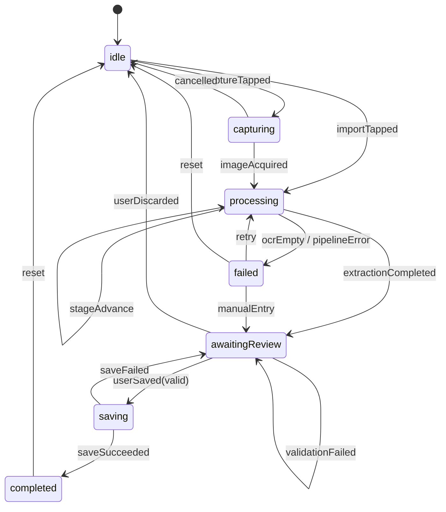

# 名片全能王（CamCard）核心功能切片 · 规格说明书

| 项 | 内容 |
| --- | --- |
| 文档编号 | SPEC-CAMCARD-CORE-001 |
| 版本 | v1.0.0（基线） |
| 状态 | 待评审 → 评审通过后冻结，变更须走附录 D 变更记录 |
| 目标平台 | iOS 17.0+ / Swift 5.9 / SwiftUI |
| 交付形态 | 单机本地 App，零网络依赖 |
| 关联资产 | `ground_truth.json`（30 条虚拟名片基准集）、本文 §14 Reference Test Suite |
| 编写日期 | 2026-11-06 |

---

## 1. 文档目的与阅读指南

本文是「名片全能王（CamCard）核心功能切片 100% 黑盒复刻」项目的**唯一需求基线**，用于驱动 SDD（Spec-Driven Development）流程下的任务拆解、编码、测试与验收。文中所有 `R-xx` 为需求编号，`Txx` 为参考测试用例编号，`TCxx` 为 `ground_truth.json` 中的数据编号，三者通过 §15 追溯矩阵互相锚定。

阅读顺序建议：

1. 先读 §3 范围声明与 §4 验收口径，确认「做什么、不做什么、做到什么程度算完成」；
2. 再读 §7 数据模型与 §8 状态机，这是本项目全部行为的骨架；
3. 实现阶段以 §9 处理流水线、§10 人工校对、§11 功能规格为准；
4. 验收阶段严格按 §14 的 20 条用例逐条执行，不得删减或合并。

> 约定：文中「必须 / 禁止」为强制条款（MUST / MUST NOT），「应当」为推荐条款（SHOULD），「可以」为可选条款（MAY）。强制条款未实现即判定该需求不通过。

---

## 2. 术语与缩写

| 术语 | 英文 / 缩写 | 定义 |
| --- | --- | --- |
| 核心切片 | Core Slice | 从名片夹到导出的最小可用闭环，不含任何账号与企业能力 |
| 黑盒复刻 | Black-box Replication | 仅依据外部可观察行为复刻，不参考、不反编译原 App 源码与资源 |
| 人工校对 | Human-in-the-Loop, HITL | OCR 与字段抽取结果必须经用户确认后才可入库的交互环节 |
| 区域检测 | Rectangle Detection | 在拍摄图中定位名片四边形边界 |
| 透视校正 | Perspective Correction | 将倾斜四边形映射为正视矩形图像 |
| 字段抽取 | Field Extraction | 从 OCR 文本行推断 name/company 等结构化字段 |
| 草稿 | ScanDraft | 校对阶段尚未确认的临时结果，可恢复、可丢弃 |
| 归一化 | Normalization | 字段值写入前的确定性清洗与格式化（见 §7.3） |
| 置信度 | Confidence | 0.0–1.0 的识别可信程度，来源为 OCR 行置信度与规则得分 |
| 金样本 | Golden Sample | 全字段齐全、用于回归基线的高质量数据（TC29） |

---

## 3. 范围声明

### 3.1 范围内（In Scope）

本项目**仅**复刻以下单机本地闭环，共 10 个能力域：

| 编号 | 能力域 | 说明 |
| --- | --- | --- |
| S1 | 名片夹 | 列表、空态、排序、筛选、搜索、详情入口 |
| S2 | 采集 | 相机拍摄、相册导入、文件（图片）导入 |
| S3 | 区域检测与校正 | 自动检测四角、透视校正、手动调整四角兜底 |
| S4 | 本地 OCR | 基于系统 Vision 框架的中英文文本识别，全程离线 |
| S5 | 字段抽取 | 从乱序文本中抽取 10 个业务字段并归一化 |
| S6 | 人工校对 | 字段级编辑、忽略、置信度提示、确认入库 |
| S7 | 本地持久化 | SwiftData 元数据 + 沙盒图片文件，冷启动可恢复 |
| S8 | 卡片管理 | 详情、编辑、删除、5 秒撤销、重复检测提示 |
| S9 | 导出 | CSV、vCard 3.0、单卡分享 |
| S10 | 设置 | 自动保存开关、默认导出格式、清空数据、隐私说明 |

闭环主链路（必须端到端可用）：

```
名片夹 → 拍摄/导入 → 区域检测 → 透视校正 → OCR → 字段抽取
      → 人工校对与确认 → 本地持久化 → 详情/搜索/导出
```

### 3.2 范围外（Out of Scope）

以下能力**明确不实现**，不得出现在代码、界面、接口或数据模型中；若第三方依赖被动引入相关能力，视为范围污染：

| 类别 | 排除项 |
| --- | --- |
| 云端与账号 | 云同步、iCloud 同步、账号注册登录、多设备漫游、云端备份 |
| 商业化 | 会员、订阅、付费解锁、广告、积分、邀请返利 |
| 企业能力 | CRM、客户跟进、商机、团队空间、企业目录、审批、工单 |
| 社交 | 名片交换、扫码加好友、通讯录匹配、人脉推荐、IM |
| 在线智能 | 云端 OCR、在线翻译、AI 润色、智能补全、大模型问答 |
| 多端 | Android、Web、macOS、Watch、小程序、浏览器插件 |
| 办公周边 | 发票识别、日程提醒、地图导航、邮件营销、名片打印 |
| 数据运营 | 埋点上报、行为分析、A/B 实验、崩溃日志上传 |
| 视觉复刻 | 原 App 图标、插画、字体、文案的 1:1 像素级拷贝 |

### 3.3 边界判定原则

1. **零业务网络请求**：除系统分享面板与 `openURL`（拨号、邮件、浏览器）外，App 不得发起任何 HTTP 请求；测试以 `URLProtocol` 探针断言请求数为 0。
2. **单用户单设备**：不存在用户概念，所有数据属于当前设备沙盒。
3. **可删除、可导出**：任何本地数据必须能被用户一键清空，且能以开放格式导出。
4. **行为等价优先于视觉等价**：允许字体、间距、动效与原 App 不同；状态流转、字段口径、异常分支必须一致。
5. **合规优先**：不得使用真实个人名片数据；所有测试与演示数据均来自 `ground_truth.json` 的虚拟样本。

---

## 4. 产品目标与验收口径

### 4.1 复刻目标

在无网络环境下，用户从零开始完成「拍一张名片 → 得到一张结构化电子名片 → 可检索、可导出」的完整任务，全程不超过 6 次点击、不超过 8 秒（真机 iPhone 12 及以上，良好光照）。

### 4.2 成功指标（验收门槛）

| 指标 | 门槛 | 测量方式 |
| --- | --- | --- |
| 参考测试通过率 | 20 / 20，且无跳过 | §14 全量执行 |
| 字段抽取准确率 | 30 条数据集上，name/company/mobile/email 精确匹配率 ≥ 95%，全字段宏平均 ≥ 90% | §15.2 评测脚本 |
| 缺失字段正确率 | 标注为 null 的字段，输出 null 的比例 = 100%（禁止空串、禁止臆造） | 同上 |
| 崩溃率 | 20 条用例执行期间 0 崩溃 | XCTest / 手工 |
| 离线可用 | 飞行模式下全流程可用 | 手工 |
| 冷启动 | ≤ 1.5s（iPhone 12，1000 张卡） | `XCTOSSignpostMetric` |
| 拍摄到校对页 | p95 ≤ 4.0s（12MP 输入） | 性能埋点 |

### 4.3 用户旅程（正常路径）

1. 用户打开 App，进入名片夹（首次为空态）。
2. 点击「拍摄名片」或「导入图片」，获得原始图像。
3. 系统自动检测名片边界并做透视校正；失败时降级为原图并提示。
4. 系统本地 OCR，按阅读顺序还原文本行。
5. 系统抽取字段并给出置信度，进入校对页。
6. 用户逐字段核对、修改、补全，点击「保存」。
7. 卡片入库，可在列表搜索、在详情查看、导出为 CSV / vCard。

---

## 5. 用户与用例

| 角色 | 描述 | 核心诉求 |
| --- | --- | --- |
| 商务人士（主角色） | 频繁参加展会、拜访客户 | 快速录入、准确、可检索 |
| 行政助理 | 代团队整理名片 | 批量校对、导出表格 |
| 求职者 | 收集招聘方信息 | 离线、隐私安全 |

用例清单（UC）：

| 编号 | 用例 | 关联需求 |
| --- | --- | --- |
| UC-01 | 拍摄并保存一张中文名片 | R-01 ~ R-08 |
| UC-02 | 从相册导入英文名片 | R-01, R-04 ~ R-08 |
| UC-03 | 校对并修正识别错误的字段 | R-07 |
| UC-04 | 搜索某公司或某号码 | R-09 |
| UC-05 | 查看、编辑、删除名片 | R-10 |
| UC-06 | 导出全部名片为 CSV / vCard | R-11 |
| UC-07 | 识别失败后重试或手动录入 | R-13 |

---

## 6. 系统架构

### 6.1 技术栈与平台约束

| 项 | 选型 | 约束 |
| --- | --- | --- |
| 语言 | Swift 5.9 | 开启 Strict Concurrency（complete） |
| UI | SwiftUI | 不使用 UIKit 为主结构；相机页可用 `UIViewControllerRepresentable` 包装 |
| 持久化 | SwiftData（iOS 17+） | 单 ModelContainer；测试用内存容器 |
| OCR | Vision `VNRecognizeTextRequest` | `.accurate`，语言 `zh-Hans`, `en-US` |
| 区域检测 | Vision `VNDetectRectanglesRequest` | 单目标、最大面积优先 |
| 校正 | Core Image `CIPerspectiveCorrection` | sRGB 输出 |
| 相机 | AVFoundation `AVCaptureSession` | 自定义取景页，便于控制拍摄时机 |
| 相册 | PhotosUI `PHPickerViewController` | 不申请完整相册权限 |
| 导出 | 自研 CSV / vCard 序列化 + `ShareLink` | 文件写入临时目录 |
| 三方依赖 | 0 个 | 禁止引入任何网络、统计、UI 组件库 |
| 最低系统 | iOS 17.0 | 不使用 iOS 18 API |

### 6.2 分层与依赖规则

```
┌──────────────────────────────────────────────┐
│ Presentation  SwiftUI Views + @Observable VM │
├──────────────────────────────────────────────┤
│ Domain        Entities / UseCases / Ports    │
├──────────────────────────────────────────────┤
│ Data          SwiftData / FileStore / Repo   │
├──────────────────────────────────────────────┤
│ Platform      Vision / Camera / Photos / IO  │
└──────────────────────────────────────────────┘
```

依赖方向**只能自上而下**：

- Presentation 依赖 Domain，不得直接 import SwiftData 或 Vision；
- Domain 不依赖任何框架（仅 Foundation），通过 Port 协议向外索要能力；
- Data 与 Platform 实现 Domain 定义的 Port；
- 所有跨层数据传递使用值类型（struct / enum），禁止把 `@Model` 对象泄漏到 View 层。

### 6.3 目录结构（实现基线）

```
CamCardClone/
├── App/
│   ├── CamCardCloneApp.swift          # @main，注入 AppEnvironment
│   ├── AppEnvironment.swift           # 依赖容器（live / mock）
│   └── RootView.swift                 # TabView：名片夹 / 设置
├── Features/
│   ├── CardList/                      # 列表、空态、搜索、排序
│   ├── Capture/                       # 相机页、导入入口、权限处理
│   ├── ScanReview/                    # 校对页、字段行、置信度、保存
│   ├── CardDetail/                    # 详情、复制、分享
│   ├── CardEditor/                    # 编辑表单
│   ├── Export/                        # 导出选项与进度
│   └── Settings/                      # 设置、清空数据、关于
├── Domain/
│   ├── Entities/                      # BusinessCard, ScanSession, ExtractedField
│   ├── Enums/                         # ScanState, FieldState, CardSource
│   ├── Ports/                         # 协议：CardRepository, TextRecognizing...
│   └── UseCases/                      # ScanCard, SaveCard, SearchCards, ExportCards
├── Data/
│   ├── Persistence/                   # ModelContainer, @Model, 迁移
│   ├── FileStore/                     # 图片落盘、路径解析、清理
│   └── Repositories/                  # CardRepository 实现
├── Platform/
│   ├── Vision/                        # OCR、矩形检测、透视校正
│   ├── Camera/                        # AVCaptureSession 封装
│   ├── PhotoLibrary/                  # PHPicker 封装
│   └── Export/                        # CSVWriter, VCardWriter
├── Common/                            # 日志、错误、扩展、归一化工具
├── Resources/                         # Assets、Localizable.strings
└── Tests/
    ├── UnitTests/                     # 抽取、归一化、状态机、导出
    ├── IntegrationTests/              # 流水线 + 内存数据库
    └── UITests/                       # 端到端（T03、T13、T14、T20）
```

### 6.4 领域接口契约（Ports）

以下协议是编码阶段的硬约束，签名不得随意更改；测试替身必须可实现全部方法。

```swift
// 输入源
enum ImageInput { case camera(UIImage), photoLibrary(UIImage), file(URL) }

protocol RectangleDetecting {
    func detectQuad(in image: CGImage) async throws -> Quad?
}

struct Quad: Equatable {
    let topLeft: CGPoint; let topRight: CGPoint
    let bottomRight: CGPoint; let bottomLeft: CGPoint
    let confidence: Float
}

protocol PerspectiveCorrecting {
    func correct(_ image: CGImage, quad: Quad) throws -> CGImage
}

protocol TextRecognizing {
    func recognize(_ image: CGImage, languages: [String]) async throws -> OCRResult
}

struct OCRLine: Equatable {
    let text: String
    let confidence: Float          // 0...1
    let boundingBox: CGRect        // 归一化坐标，原点左下
}

struct OCRResult: Equatable {
    let lines: [OCRLine]
    let meanConfidence: Float
}

protocol FieldExtracting {
    func extract(from result: OCRResult, imageSize: CGSize) -> ExtractionResult
}

struct ExtractionResult {
    let fields: [CardField: ExtractedField]
    let overallConfidence: Float
}

struct ExtractedField: Equatable {
    let key: CardField
    var value: String?
    var confidence: Float
    var state: FieldState
    var sourceLineIndexes: [Int]
}

protocol ImagePersisting {
    func saveOriginal(_ image: UIImage, cardID: UUID) throws -> String   // 返回相对路径
    func saveProcessed(_ image: UIImage, cardID: UUID) throws -> String
    func url(for relativePath: String) -> URL
    func delete(cardID: UUID) throws
}

protocol CardRepository {
    func insert(_ card: BusinessCard) throws
    func update(_ card: BusinessCard) throws
    func delete(id: UUID) throws
    func fetchAll(sortedBy: CardSort) throws -> [BusinessCard]
    func fetch(id: UUID) throws -> BusinessCard?
    func search(_ query: String) throws -> [BusinessCard]
    func exists(matching key: String) throws -> Bool
}

protocol CardExporting {
    func exportCSV(_ cards: [BusinessCard]) throws -> URL
    func exportVCard(_ cards: [BusinessCard]) throws -> URL
}

protocol Clock { var now: Date { get } }
protocol IDGenerating { func next() -> UUID }
```

### 6.5 依赖注入与可测试性

`AppEnvironment` 为唯一依赖容器，持有上述 Port 的实例，并在启动时按 Launch Argument 切换实现：

| Launch Argument | 作用 |
| --- | --- |
| `-uitest` | 启用测试模式：内存数据库、固定时钟、固定 UUID 序列 |
| `-fixture <TCxx>` | 指定 OCR 与图像夹具 |
| `-camera-denied` | 模拟相机权限拒绝 |
| `-photo-denied` | 模拟相册权限拒绝 |
| `-ocr-confidence <0..1>` | 覆盖 OCR 行置信度 |
| `-autosave on` | 打开自动保存开关 |
| `-reset` | 清空容器与沙盒图片目录 |

约束：

- 所有时间戳必须来自 `Clock`，禁止直接调用 `Date()`；
- 所有主键必须来自 `IDGenerating`，测试中注入 `TC01` 的固定 UUID；
- 所有异步流水线在 `@MainActor` 上驱动状态机，IO 在后台 actor 执行；
- 禁止在 View 内直接创建 `VNImageRequestHandler`。

### 6.6 关键架构决策（ADR 摘要）

| 编号 | 决策 | 理由 | 代价 |
| --- | --- | --- | --- |
| ADR-01 | 采用 SwiftData 而非 CoreData | 代码量小、与 SwiftUI 集成好、iOS 17 基线可接受 | 迁移工具弱于 CoreData |
| ADR-02 | OCR 全本地（Vision） | 满足零网络与隐私要求；离线可用 | 中文竖排、艺术字准确率有限 |
| ADR-03 | 图片存文件、元数据存库 | 避免数据库膨胀；便于分享与清理 | 需保证事务一致性 |
| ADR-04 | 强制人工确认后入库 | 复刻 CamCard 的 HITL 交互；避免脏数据 | 多一步点击 |
| ADR-05 | 写入前归一化，展示时格式化 | 保证搜索、去重、导出口径一致 | 需维护格式化器 |
| ADR-06 | 状态机独立于 View | 可单测、可恢复、可防重入 | 增加一层建模成本 |

---

## 7. 数据模型 Schema

### 7.1 实体关系

```
BusinessCard 1 ──── 0..1 ScanDraft（内存/磁盘草稿，保存后删除）
BusinessCard 1 ──── 0..* ExtractedField（仅校对期存在，不持久化）
ScanSession  1 ──── 1   BusinessCard（completed 时产生）
```

持久化实体只有 `BusinessCard`；`ScanDraft` 以 JSON 文件形式存于 `Application Support/Drafts/`，用于进程被杀后的恢复。

### 7.2 BusinessCard 核心实体

| 字段 | Swift 类型 | 可空 | 约束与语义 |
| --- | --- | --- | --- |
| `id` | `UUID` | 否 | 主键，唯一，创建后不变 |
| `originalImagePath` | `String` | 否 | 原图相对路径，如 `Cards/<uuid>/original.heic` |
| `processedImagePath` | `String?` | 是 | 校正图相对路径；检测失败时等于 `originalImagePath` |
| `name` | `String?` | 是 | 姓名；双语时 `中文名 英文名` |
| `company` | `String?` | 是 | 公司/机构全称 |
| `jobTitle` | `String?` | 是 | 职位；双语时 `中文 / English` |
| `mobile` | `String?` | 是 | 手机号，规范化数字串；多值以 ` / ` 分隔 |
| `phone` | `String?` | 是 | 办公/座机（office），不含传真；多值同上 |
| `fax` | `String?` | 是 | **扩展字段**：传真；多值同上 |
| `email` | `String?` | 是 | 小写邮箱 |
| `website` | `String?` | 是 | 规范化 URL，含 `https://`，无末尾斜杠 |
| `address` | `String?` | 是 | 通信地址，多行已合并 |
| `tags` | `[String]` | 否 | 默认 `[]`，去重，单项 ≤ 20 字符 |
| `notes` | `String?` | 是 | 备注，≤ 2000 字符 |
| `createdAt` | `Date` | 否 | 首次保存时间，UTC 存储 |
| `updatedAt` | `Date` | 否 | **扩展字段**：最后修改时间 |
| `source` | `CardSource` | 否 | **扩展字段**：`.camera` / `.photoLibrary` / `.file` / `.manual` |
| `searchIndex` | `String` | 否 | 派生字段：归一化检索串，保存时重建 |

> 扩展字段说明：题面要求的 14 个核心字段全部保留且语义不变；`fax`、`updatedAt`、`source`、`searchIndex` 为实现「多号码区分、审计、检索」所必需的工程扩展，已在此显式声明。`ground_truth.json` 同样包含 `fax` 键（缺失为 `null`），以保证 30 条记录 schema 完全一致。

**SwiftData 声明（基线）**

```swift
@Model
final class BusinessCard {
    @Attribute(.unique) var id: UUID
    var originalImagePath: String
    var processedImagePath: String?
    var name: String?
    var company: String?
    var jobTitle: String?
    var mobile: String?
    var phone: String?
    var fax: String?
    var email: String?
    var website: String?
    var address: String?
    var tags: [String]
    var notes: String?
    var sourceRaw: String
    var searchIndex: String
    var createdAt: Date
    var updatedAt: Date

    var source: CardSource {
        get { CardSource(rawValue: sourceRaw) ?? .manual }
        set { sourceRaw = newValue.rawValue }
    }
}
```

**不变量**

- 所有可空字符串字段：**禁止空字符串**，无值必须为 `nil`；
- `createdAt ≤ updatedAt`；
- `originalImagePath` 指向的文件必须存在，否则读取时进入 `E-DB-002` 修复流程；
- `tags` 元素非空、去重、保持插入顺序；
- `searchIndex` 必须在每次 `insert/update` 后重建，不得为空串（无内容时为 `" "` 占位）。

### 7.3 字段语义与归一化规则

归一化在**写入前**执行一次，展示层只做格式化（如号码分组），不得反向修改存储值。

| 编号 | 规则 | 说明 |
| --- | --- | --- |
| N1 | Unicode NFC、全角转半角 | 数字、拉丁字母、`＠`、`：` 等统一 |
| N2 | 去除零宽字符与不可见控制符 | `\u200B`、`\uFEFF` 等 |
| N3 | 连续空白折叠为 1 个空格并 trim | 含换行、制表符 |
| N4 | CJK 与 CJK 之间的空白全部删除 | `顾 清 和` → `顾清和`；CJK 与数字/拉丁之间保留 1 空格 |
| N5 | 电话号码仅保留数字，保留前导 `+` | `(021) 0000-2222` → `02100002222` |
| N6 | 中国大陆号码去除国家码 `86` | `+86 136 0000 5555` → `13600005555`；港澳台及海外保留 `+CC` |
| N7 | 多值字段以 ` / ` 连接 | 先各自归一化，再按原文顺序拼接 |
| N8 | 邮箱转小写 | 保留 `+` 标签与子域名 |
| N9 | 网址转小写，补 `https://`，去末尾 `/` | 保留 `www`；不做短链展开 |
| N10 | 双语职位统一为 `中文 / English` | 与原文顺序无关 |
| N11 | 双语姓名统一为 `中文 英文`（单个空格） | 仅同一视觉行或紧邻行合并 |
| N12 | 地址多行合并 | 中文行直接拼接；英文行以 `, ` 拼接 |
| N13 | 空值统一为 `nil` | 禁止 `""`、`" "`、`"N/A"`、`"-"` |
| N14 | 姓名/公司不做大小写改写 | 保留原文大小写（专有名词优先） |

**字段口径**

| 字段 | 取值口径 | 典型误判防御 |
| --- | --- | --- |
| `name` | 人名，2–4 个 CJK 或 2–4 个英文词（支持 `Jr.`/`III`） | 排除含 `@`、`http`、纯数字、公司后缀的行 |
| `company` | 机构全称，保留括号与后缀 | 与姓名同行的公司需按分隔符拆分 |
| `jobTitle` | 职位/头衔，可多段 | 排除含电话、地址的行 |
| `mobile` | 手机号（CN 11 位、国际 `+CC` 移动号） | 由 `手机/Mobile/M/Cell` 锚点优先判定 |
| `phone` | 座机/总机/办公电话 | 带 `Fax/传真` 上下文时不得落入此字段 |
| `fax` | 传真号 | 仅 `Fax/传真/F` 锚点或紧随其后的号码 |
| `email` | RFC 5322 简化匹配 | 排除 `@` 后无有效域名的情况 |
| `website` | 域名或 URL | 排除邮箱 `@` 后的域名片段 |
| `address` | 含行政区/街道/门牌/楼层 | 排除纯邮编行单独成址 |

### 7.4 枚举定义

```swift
enum CardSource: String, Codable, CaseIterable {
    case camera, photoLibrary, file, manual
}

enum ScanState: Equatable {
    case idle
    case capturing
    case processing(ProcessingStage)
    case awaitingReview
    case saving
    case completed(cardID: UUID)
    case failed(ScanFailure)
}

enum ProcessingStage: String, Equatable {
    case detecting, correcting, recognizing, extracting
}

enum ScanFailure: Equatable {
    case permissionDenied(PermissionKind)
    case imageUnreadable
    case ocrEmpty
    case ocrTimeout
    case persistenceFailed
    case interrupted
}

enum PermissionKind: String { case camera, photoLibrary }

enum FieldState: String, Equatable {
    case empty          // 无候选
    case suggested      // 有候选未确认
    case edited         // 用户改过
    case confirmed      // 用户确认
    case dismissed      // 用户忽略
}

enum CardField: String, CaseIterable {
    case name, company, jobTitle, mobile, phone, fax, email, website, address
}

enum CardSort: String, CaseIterable {
    case createdAtDesc, nameAsc, companyAsc, updatedAtDesc
}
```

### 7.5 辅助实体

**ScanSession（内存对象，驱动状态机）**

| 属性 | 类型 | 说明 |
| --- | --- | --- |
| `id` | `UUID` | 会话 ID，保存幂等键 |
| `state` | `ScanState` | 当前状态 |
| `input` | `ImageInput?` | 输入源 |
| `originalImage` | `CGImage?` | 解码后的原图 |
| `quad` | `Quad?` | 检测结果 |
| `processedImage` | `CGImage?` | 校正结果 |
| `ocrResult` | `OCRResult?` | OCR 结果 |
| `extraction` | `ExtractionResult?` | 抽取结果 |
| `startedAt` | `Date` | 会话开始时间 |

**ScanDraft（磁盘 JSON，位于 `Application Support/Drafts/<sessionID>.json`）**

| 字段 | 类型 | 说明 |
| --- | --- | --- |
| `sessionID` | `UUID` | 主键 |
| `originalPath` / `processedPath` | `String` | 相对路径 |
| `fields` | `[String: DraftField]` | 键为 `CardField.rawValue` |
| `overallConfidence` | `Double` | 整体置信度 |
| `savedAt` | `Date` | 草稿时间 |
| `source` | `String` | 来源 |

草稿在进入 `awaitingReview` 时写入，`completed` 或 `discarded` 时删除；App 启动时若发现草稿且原图存在，提示「继续上次编辑」。

### 7.6 索引、唯一性与去重

- 唯一键：`id`。
- 去重键（保存前校验，非数据库唯一约束）：
  - 主键 1：规范化 `mobile` 完全相等；
  - 主键 2：`name + "|" + company`（均归一化、小写）完全相等。
- 命中任一主键即提示「可能重复」，用户可选择「仍然保存」。
- `searchIndex` 组成：`name` 原文 + 全拼 + 首字母 + `company` 原文 + 全拼 + `jobTitle` + 纯数字号码 + 小写 `email` + 小写 `website` + `address` + `tags` + `notes`，以 `\u{1F}` 分隔。

### 7.7 持久化与迁移

| 项 | 规格 |
| --- | --- |
| 容器 | `ModelContainer(for: BusinessCard.self)`，store 位于 `Application Support/default.store` |
| 图片目录 | `Application Support/Cards/<cardID>/original.heic`、`processed.heic` |
| 写入原子性 | 先写临时文件 → `replaceItemAt`；数据库与文件任一失败则回滚 |
| 路径策略 | 只存相对路径，启动时以容器 URL 拼接，兼容沙盒路径变化 |
| 迁移 | `SchemaV1` 基线；后续字段新增走 `VersionedSchema` + `MigrationPlan` |
| 清理 | 删除卡片时删除整个 `Cards/<cardID>/` 目录；`Drafts/` 超过 7 天自动清理 |
| 备份 | 不实现 iCloud 备份开关；系统备份随沙盒默认行为 |

### 7.8 导出数据契约

**CSV 列顺序（固定 14 列）**

```
id,name,company,jobTitle,mobile,phone,fax,email,website,address,tags,notes,createdAt,updatedAt
```

- 编码 UTF-8 **带 BOM**（兼容 Excel 中文）；
- 逗号、双引号、换行按 RFC 4180 转义（字段整体加双引号，内部 `"` 变 `""`）；
- `nil` 输出空字符串；
- `tags` 以 `|` 连接；
- 时间格式 `ISO8601DateFormatter`（含时区，如 `2026-01-01T10:00:00+08:00`）；
- 文件名 `CamCards_yyyyMMdd_HHmmss.csv`。

**vCard 3.0 映射**

| 字段 | 属性 | 说明 |
| --- | --- | --- |
| name | `FN` + `N` | `N` 对中文按 `姓;名;;;` 拆分，无法拆分时整体放 `FN` |
| company | `ORG` | 分号转义 |
| jobTitle | `TITLE` | |
| mobile | `TEL;TYPE=CELL` | 多值拆多行 |
| phone | `TEL;TYPE=WORK,VOICE` | |
| fax | `TEL;TYPE=WORK,FAX` | |
| email | `EMAIL;TYPE=INTERNET` | |
| website | `URL` | |
| address | `ADR;TYPE=WORK:;;街道;城市;省;邮编;国家` | 无法结构化时整体放第一段 |
| notes | `NOTE` | 换行转 `\n` |
| tags | `CATEGORIES` | 逗号连接 |
| createdAt | `REV` | ISO8601 |

- 每张卡一个 `BEGIN:VCARD ... END:VCARD`；
- 行长度 > 75 字节时折行，续行以单个空格开头；
- 空字段整行省略；
- 文件名 `CamCards_yyyyMMdd_HHmmss.vcf`。

---

## 8. 状态机

### 8.1 会话状态定义

| 状态 | 语义 | 可停留 | UI 表现 |
| --- | --- | --- | --- |
| `idle` | 无进行中的扫描 | 是 | 名片夹 / 拍摄入口 |
| `capturing` | 相机取景或相册选择中 | 是 | 取景页 / 选择器 |
| `processing(.detecting)` | 检测名片边缘 | 否 | 进度「正在检测边缘」 |
| `processing(.correcting)` | 透视校正 | 否 | 进度「正在校正」 |
| `processing(.recognizing)` | OCR | 否 | 进度「正在识别文字」 |
| `processing(.extracting)` | 字段抽取 | 否 | 进度「正在整理字段」 |
| `awaitingReview` | 等待人工确认 | 是 | 校对页 |
| `saving` | 写库与落盘 | 否 | 保存中，按钮禁用 |
| `completed(cardID)` | 已完成并入库 | 是（可 reset） | 详情 / 列表 |
| `failed(reason)` | 失败，可重试 | 是 | 错误页 |

### 8.2 状态转换表

| # | 当前状态 | 事件 | 守卫条件 | 目标状态 | 副作用 |
| --- | --- | --- | --- | --- | --- |
| 1 | idle | `captureTapped` | 相机权限 ≠ denied | capturing | 打开相机；记录 sessionID |
| 2 | idle | `captureTapped` | 相机权限 = denied | failed(.permissionDenied(.camera)) | 弹窗引导设置 |
| 3 | idle | `importTapped` | 无 | processing(.detecting) | 打开选择器，选中后开始 |
| 4 | capturing | `imageAcquired` | 图像可解码 | processing(.detecting) | 保存原图到临时目录 |
| 5 | capturing | `cancelled` | 无 | idle | 释放相机，清理临时文件 |
| 6 | processing(.detecting) | `quadDetected` | 置信度 ≥ 0.3 | processing(.correcting) | 保存 quad，UI 标注四角 |
| 7 | processing(.detecting) | `quadNotFound` | 无 | processing(.recognizing) | 降级：processed = original，warning = E-DET-001 |
| 8 | processing(.correcting) | `correctionSucceeded` | 输出非空 | processing(.recognizing) | 写 processed 临时文件 |
| 9 | processing(.correcting) | `correctionFailed` | 无 | processing(.recognizing) | 降级为原图，记录 E-IMG-003 |
| 10 | processing(.recognizing) | `ocrFinished` | `lines.count > 0` | processing(.extracting) | 保存 OCRResult |
| 11 | processing(.recognizing) | `ocrEmpty` | `lines.count == 0` | failed(.ocrEmpty) | 保留原图供重试 |
| 12 | processing(.recognizing) | `timeout` | 超时 > 15s | failed(.ocrTimeout) | 取消 Vision 任务 |
| 13 | processing(.extracting) | `extractionCompleted` | 无 | awaitingReview | 写草稿；进入校对页 |
| 14 | processing(any) | `pipelineError` | 无 | failed(reason) | 记录错误；保留可诊断信息 |
| 15 | awaitingReview | `userSaved` | 校验通过且非 saving | saving | 禁用按钮；启动事务 |
| 16 | awaitingReview | `userSaved` | 校验失败 | awaitingReview | 展示 E-VAL-001，不写库 |
| 17 | awaitingReview | `userDiscarded` | 无 | idle | 删除草稿与临时图片 |
| 18 | saving | `saveSucceeded(cardID)` | 无 | completed(cardID) | 写卡片；删草稿；刷新列表 |
| 19 | saving | `saveFailed` | 无 | awaitingReview | 回滚事务；提示 E-DB-001 可重试 |
| 20 | saving | `userSaved` | 已在 saving | saving | **幂等忽略**，不重复写 |
| 21 | failed(any) | `retry` | 失败可重试 | processing(.detecting) | 复用原图，重置下游结果 |
| 22 | failed(any) | `manualEntry` | 无 | awaitingReview | 空字段草稿，进入人工录入 |
| 23 | failed(any) | `reset` | 无 | idle | 清理临时文件 |
| 24 | completed | `reset` | 无 | idle | 关闭详情，回到列表 |
| 25 | any | `appBackgrounded` | 处理中 | 保持状态 | 允许 ≤ 10s 继续，超时转 failed(.interrupted) |

### 8.3 字段级状态机

| 当前 | 事件 | 目标 | 说明 |
| --- | --- | --- | --- |
| empty | `candidateFound` | suggested | 抽取结果写入 |
| suggested | `userEdited` | edited | 值变化即置 edited |
| suggested | `userConfirmed` | confirmed | 单独确认某字段 |
| suggested | `userDismissed` | dismissed | 置 nil，且不再回填 |
| edited | `userConfirmed` | confirmed | |
| confirmed | `userEdited` | edited | 再次修改需重新确认 |
| any | `reset` | empty | 重试 / 重新识别 |

### 8.4 不变量与非法转换

| 编号 | 不变量 |
| --- | --- |
| I1 | 只有 `saving → completed` 允许产生 `BusinessCard` 记录 |
| I2 | `completed` 不可直接回到 `processing`，必须经 `reset` |
| I3 | 同一 `sessionID` 最多产生 1 条卡片（幂等） |
| I4 | `saving` 期间拒绝一切输入事件（除 `saveFailed`） |
| I5 | 状态转换必须在主线程串行执行，转换函数为纯同步 |
| I6 | `failed` 不可直接进入 `completed` |
| I7 | `awaitingReview` 允许字段全空（手动录入场景），但保存必须通过 §10.3 校验 |
| I8 | 任何时刻 `originalImagePath` 不得为空 |

非法事件处理：状态机忽略该事件、保持当前状态、写一条 `E-STATE-001` 日志（含 from/to/event），并在 Debug 下触发断言；Release 下静默降级，禁止崩溃。

### 8.5 中断与恢复

| 场景 | 行为 |
| --- | --- |
| 处理中进入后台 ≤ 10s | 继续执行，回前台展示最新状态 |
| 处理中进入后台 > 10s | 取消任务 → `failed(.interrupted)`，回前台提示重试 |
| 校对页被杀进程 | 启动时读草稿，弹「继续上次编辑 / 丢弃」 |
| 保存中被杀进程 | 事务原子性保证：要么 0 条、要么 1 条；启动时校验 `Cards/<id>/` 与数据库一致性 |
| 低内存警告 | 释放 `originalImage` 的 CGImage 缓存，保留文件路径；必要时降级重跑 OCR |
| 磁盘写满 | `E-DB-001`，提示清理空间，保留草稿 |

### 8.6 状态图



> 说明：`processing` 内部按 `detecting → correcting → recognizing → extracting` 顺序推进；`quadNotFound` 与 `correctionFailed` 为降级边，不改变主路径。

---

## 9. 图像处理与 OCR 流水线

### 9.1 采集

| 输入 | 实现 | 约束 |
| --- | --- | --- |
| 相机 | `AVCaptureSession` + 自定义取景页 | 后置广角；拍照后展示确认页（重拍 / 使用） |
| 相册 | `PHPickerViewController`（`images` 过滤） | 不申请完整相册权限；单张选择 |
| 文件 | `UIDocumentPickerViewController`（`public.image`） | 仅图片；拒绝 PDF |

- 原图统一转为 `CGImage`，按 EXIF 方向校正；
- 长边 > 4096px 时等比缩放至 4096，避免内存峰值；
- 原图以 HEIC（质量 0.9）落盘，校正图以 HEIC（质量 0.9）落盘。

### 9.2 区域检测

```swift
let request = VNDetectRectanglesRequest()
request.maximumObservations = 3
request.minimumConfidence = 0.3
request.minimumAspectRatio = 0.2
request.quadratureTolerance = 30
request.minimumSize = 0.25
```

- 输入为缩放后的灰度/彩色图均可，使用 `.up` 方向；
- 多个候选中按 `面积 × 置信度` 取最大；
- 四角排序：TL、TR、BR、BL（按图像坐标系）；
- 外扩 2% 边距，避免裁掉边缘文字；
- 检测失败（无候选或置信度 < 0.3）→ 走 `quadNotFound` 降级。

### 9.3 透视校正

- `CIPerspectiveCorrection`，输入 `CIImage` + 四角 `CIVector`；
- 输出尺寸按四边形长短边估算，长边不小于 1000px，且不超过 3000px；
- 色彩空间 sRGB，输出 `CGImage`；
- 校正失败（输出为空 / 尺寸异常）→ 降级使用原图，记录 `E-IMG-003`。

### 9.4 预处理

- 不做二值化（保留彩色，提升低对比度名片的可读性）；
- 仅做方向归一与轻度降噪（`CINoiseReduction`，`noiseLevel = 0.02`，可关闭）；
- 校正图直接送入 OCR，不做二次裁切。

### 9.5 OCR

```swift
let request = VNRecognizeTextRequest()
request.recognitionLevel = .accurate
request.recognitionLanguages = ["zh-Hans", "en-US"]
request.usesLanguageCorrection = true
request.minimumTextHeight = 0.01
request.automaticallyDetectsLanguage = true
```

- 每行结果保留 `topCandidates(1)` 的文本与置信度；
- 置信度 < 0.3 的行仍然保留（供人工校对参考），但标记为低置信；
- 整体超时 15s，超时抛 `E-OCR-002`；
- 空结果（0 行）抛 `E-OCR-001`。

### 9.6 行聚合与阅读顺序

1. 以行高中位数 `h` 为基准，纵向重叠 > 0.5h 的行归为同一视觉行；
2. 同一视觉行内按 x 升序拼接，间隔 > 1.5h 时插入空格；
3. 视觉行按 y 降序（自上而下）排列；
4. 对竖排文本（宽 < 高且字符数 ≤ 4 的连续行），按列聚合为一行；
5. 输出 `[OCRLine]`，`boundingBox` 保留原始坐标，供校对页高亮联动。

### 9.7 字段抽取

**候选生成**

- 锚点匹配：`手机|电话|传真|邮箱|邮件|网址|网站|地址|公司|职位|职务|姓名|Mobile|Tel|Phone|Fax|Email|E-mail|Web|Site|Address|Company|Title|Name` 后接 `[:：\s]`；
- 模式匹配：邮箱、URL、手机号、座机号、国际号、邮编；
- 位置启发：图像上方 35% 更可能是姓名/公司/职位，下方 25% 更可能是地址；
- 词典匹配：公司后缀（有限公司、股份、集团、事务所、LLP、Inc.、Ltd.、LLC、GmbH、Co.）、职位词典（总监、经理、主管、工程师、合伙人、律师、医师、教授、Founder、Director、Manager、Engineer、Partner、Head of）。

**评分**

```
score = 0.45 × 锚点命中
      + 0.30 × 模式匹配强度
      + 0.15 × 位置先验
      + 0.10 × 词典命中
```

- `score ≥ 0.55` 才写入候选值；`≥ 0.75` 记为高置信；
- 同一行只允许分配给一个字段，冲突优先级：`mobile > fax > phone > email > website > address > jobTitle > company > name`；
- 无候选 → `nil`，`FieldState.empty`。

**字段特殊规则**

- `mobile`：CN `1[3-9]\d{9}`；国际 `+CC` 且上下文含 Mobile/Cell；
- `phone`：`0\d{2,3}` 区号 + 7–8 位；400/800 号码；上下文含 Tel/Office/O；
- `fax`：仅 `Fax/传真/F` 上下文；
- `email`：RFC 5322 简化正则，排除图片域名误判；
- `website`：域名或 URL，排除 `@` 后片段；
- `address`：含省/市/区/路/街/号/大厦/层/室，或英文 Street/Road/Ave/Suite/Floor/ZIP。

### 9.8 置信度

| 层级 | 计算 | 用途 |
| --- | --- | --- |
| 行置信度 | Vision 返回 | 展示、加权 |
| 字段置信度 | `0.6 × 行置信度 + 0.4 × 规则得分` | 字段标记 |
| 整体置信度 | 非空字段置信度的加权平均（name/company 权重 1.5，其余 1.0） | 自动保存判定 |

阈值：

- 整体 ≥ 0.85 且所有字段 ≥ 0.6 → 高置信；
- 0.60 ≤ 整体 < 0.85 → 中置信，展示「建议核对」；
- 整体 < 0.60 → 低置信，展示醒目警示条，禁止自动保存。

### 9.9 性能预算

| 阶段 | 目标（iPhone 12，12MP） | 上限 |
| --- | --- | --- |
| 解码 + 缩放 | 150ms | 300ms |
| 区域检测 | 300ms | 600ms |
| 透视校正 | 200ms | 400ms |
| OCR | 1800ms | 3000ms |
| 字段抽取 | 50ms | 150ms |
| 合计（拍摄→校对页） | 2500ms | 4000ms |
| 内存峰值 | 180MB | 250MB |

---

## 10. 人工校对（Human-in-the-Loop）

### 10.1 页面结构

```
┌───────────────────────────────────────┐
│  ‹ 返回        校对名片       重拍/重选 │
├───────────────────────────────────────┤
│  [校正图缩略图，可点开全屏，支持双指缩放] │
│  ⚠ 识别置信度较低，请逐项核对（低置信时） │
├───────────────────────────────────────┤
│  姓名     陈亦舟                  ✎ ✕  │
│  公司     星澜科技（深圳）有限公司   ✎ ✕  │
│  职位     产品总监                ✎ ✕  │
│  手机     13800001234   [高]      ✎ ✕  │
│  办公电话 075500005678  [中]      ✎ ✕  │
│  传真     未填写                  ✎ ✕  │
│  邮箱     chen.yizhou@example.com ✎ ✕  │
│  网址     https://www.example.com ✎ ✕  │
│  地址     深圳市…                  ✎ ✕  │
├───────────────────────────────────────┤
│        [ 保存名片 ]      [ 放弃 ]      │
└───────────────────────────────────────┘
```

### 10.2 交互规则

| 编号 | 规则 |
| --- | --- |
| H1 | 所有字段均可编辑；点击字段行进入行内编辑，键盘类型按字段切换（电话=数字键盘，邮箱/网址=URL 键盘） |
| H2 | 点击字段行时，上方缩略图高亮对应 `boundingBox`；再次点击取消 |
| H3 | 每个字段右侧展示置信度圆点：高=绿、中=黄、低=红；低置信字段默认聚焦第一个 |
| H4 | 清除按钮（✕）将值置 `nil`，状态置 `dismissed`，不得回填 |
| H5 | 「重拍/重选」丢弃当前结果，回到采集；需二次确认 |
| H6 | 返回手势 / 返回按钮：若存在未保存修改，弹出「保存 / 放弃 / 继续编辑」 |
| H7 | 空字段展示占位「未填写」，不得展示空字符串或 `null` |
| H8 | 保存成功后进入详情页，展示 toast「已保存」，支持「撤销」5 秒 |
| H9 | 低置信（整体 < 0.6）时顶部警示条不可关闭，保存按钮文案改为「核对并保存」 |

### 10.3 保存校验

保存必须同时满足：

1. `name` 或 `company` 至少一个非空（trim 后非空，仅空白视为空）；
2. 至少一个字段非空（防止完全空卡片）；
3. 不存在 `saving` 中的并发保存；
4. 未命中重复键，或用户已确认「仍然保存」。

校验失败展示 `E-VAL-001`：「请至少填写姓名或公司」，按钮保持可用但点击不写库。

### 10.4 自动保存（可选能力）

- 设置项「高置信度自动保存」默认**关闭**；
- 开启后，仅当整体置信度 ≥ 0.85 且所有字段 ≥ 0.6 时，进入 `awaitingReview` 1 秒后自动保存；
- 自动保存后展示 5 秒撤销；
- 低置信永不自动保存（T08 验证）。

---

## 11. 功能规格

### 11.1 名片夹（R-09）

| 项 | 规格 |
| --- | --- |
| 布局 | 单列卡片列表，左侧头像占位（姓名首字），主标题姓名/公司，副标题职位，第三行主号码 |
| 空态 | 插画 + 「还没有名片」+ 「拍摄名片」「导入图片」两个按钮 |
| 排序 | 默认 `createdAt` 降序；可切换姓名升序、公司升序、最近修改 |
| 筛选 | 按标签筛选（多选，OR 语义） |
| 滑动操作 | 左滑删除，右滑收藏（`tags` 追加「收藏」） |
| 下拉刷新 | 无网络，仅重载本地数据（400ms 动画） |
| 大列表 | 1000 条时滚动 60fps，使用 `LazyVStack` |

### 11.2 搜索（R-09）

- 搜索框置于列表顶部，输入即搜，防抖 200ms；
- 匹配范围：`searchIndex` 全字段；
- 匹配方式：大小写不敏感、变音符号不敏感；中文支持子串；中文支持全拼与首字母；号码忽略格式（纯数字匹配）；
- 排序：完全匹配 > 前缀匹配 > 包含匹配；同级别按 `updatedAt` 降序；
- 高亮命中片段；
- 空查询恢复全部；无结果展示「未找到相关名片」；
- 特殊字符（`%`、`_`、`'`、`;`）必须安全处理，禁止拼接 SQL。

### 11.3 详情（R-10）

- 顶部大图（校正图，缺失时用原图），支持双击放大、双指缩放；
- 字段分组：基本信息（姓名/公司/职位）、联系方式（手机/办公/传真/邮箱/网址）、其他（地址/标签/备注/时间）；
- 点击号码：复制 + 触觉反馈 + toast；长按提供「拨打 / 复制」；
- 点击邮箱：复制；长按提供「发送邮件」；
- 点击网址：`openURL` 打开浏览器；
- 空字段不展示行（详情页与校对页规则不同）；
- 底部操作：编辑、分享（vCard）、删除。

### 11.4 编辑 / 删除 / 撤销（R-10）

| 操作 | 规格 |
| --- | --- |
| 编辑 | 复用校对页表单组件；保存后 `updatedAt = now`，`createdAt` 不变，重建 `searchIndex` |
| 删除 | 列表左滑或详情页删除；详情页需二次确认；删除后 5 秒内可撤销 |
| 撤销 | 内存保留快照，5 秒后清理图片目录；撤销恢复同 `id` 记录与文件 |
| 批量删除 | 不实现（超出切片范围） |

### 11.5 导出（R-11）

- 入口：设置页「导出全部」、详情页「分享此名片」；
- 格式：CSV（全部/筛选结果）、vCard（全部/单张）；
- 导出前展示数量与格式选择；
- 生成文件写入 `tmp/Exports/`，通过 `ShareLink` 分享；
- 分享完成或取消后清理临时文件；
- 导出过程展示进度，> 500 条时后台执行并显示进度条；
- 失败展示 `E-EXP-001`，保留可重试入口。

### 11.6 设置（R-10）

| 项 | 规格 |
| --- | --- |
| 自动保存 | 开关，默认关 |
| 默认导出格式 | CSV / vCard |
| 数据统计 | 名片数量、占用空间 |
| 清空数据 | 二次确认 + 输入「删除」确认；清空数据库与图片目录 |
| 隐私说明 | 静态页：数据仅存本机、不上传、无账号 |
| 关于 | 版本号、开源许可（系统框架）、虚拟数据声明 |

---

## 12. 非功能需求

| 编号 | 类别 | 要求 | 验证 |
| --- | --- | --- | --- |
| R-14 | 隐私 | 不采集、不上传任何数据；无第三方 SDK；权限文案明确 | 代码扫描 + 网络探针 |
| R-14 | 离线 | 飞行模式下全流程可用 | 手工 |
| R-15 | 性能 | 见 §9.9；冷启动 ≤ 1.5s；1000 卡搜索 ≤ 100ms | Instruments |
| R-15 | 稳定性 | 连续处理 50 张不崩溃、不 OOM | 压力测试 |
| R-16 | 可访问性 | 支持 Dynamic Type 至 XXL；VoiceOver 可读；点击区域 ≥ 44pt；对比度 ≥ 4.5:1 | Accessibility Inspector |
| R-16 | 本地化 | 主语言 zh-Hans，回退 en；日期/号码按 Locale 格式化 | 伪本地化测试 |
| — | 兼容性 | iPhone SE 3 至 iPhone 15 Pro Max；iOS 17.0–17.x | 模拟器矩阵 |
| — | 可维护性 | 单文件 ≤ 400 行；核心逻辑单测覆盖 ≥ 80% | 覆盖率报告 |

---

## 13. 错误码与异常处理

| 错误码 | 场景 | 用户可见文案 | 可恢复 | 处理 |
| --- | --- | --- | --- | --- |
| E-PERM-001 | 相机权限拒绝 | 无法访问相机，请在设置中开启 | 是 | 引导 `openSettingsURLString` |
| E-PERM-002 | 相册权限拒绝 | 无法访问相册 | 是 | 引导设置；文件导入兜底 |
| E-IMG-001 | 图像解码失败 | 图片无法读取，请换一张 | 是 | 返回采集 |
| E-IMG-002 | 图像过大/内存不足 | 图片过大，已压缩处理 | 是 | 自动降采样后重试一次 |
| E-IMG-003 | 透视校正失败 | 已使用原图继续识别 | 是 | 降级，不中断 |
| E-DET-001 | 未检测到名片边缘 | 未检测到边缘，已使用原图 | 是 | 降级 + 手动裁剪入口 |
| E-OCR-001 | 无识别文本 | 未识别到文字，请重拍或手动录入 | 是 | `failed(.ocrEmpty)` |
| E-OCR-002 | OCR 超时 | 识别超时，请重试 | 是 | 取消任务，保留原图 |
| E-EXT-001 | 字段抽取部分失败 | 部分字段未识别，请手动补充 | 是 | 空字段进入校对页 |
| E-VAL-001 | 校验失败 | 请至少填写姓名或公司 | 是 | 阻止保存 |
| E-DUP-001 | 疑似重复 | 可能已存在相同名片 | 是 | 允许仍然保存 |
| E-DB-001 | 持久化失败 | 保存失败，请重试 | 是 | 回滚，停留校对页 |
| E-DB-002 | 图片文件丢失 | 图片已丢失，仅显示文字信息 | 部分 | 详情占位 + 提示 |
| E-EXP-001 | 导出失败 | 导出失败，请重试 | 是 | 保留入口 |
| E-STATE-001 | 非法状态转换 | 无（不打扰用户） | — | 忽略事件，写日志 |
| E-INT-001 | 处理被中断 | 处理已中断，请重试 | 是 | `failed(.interrupted)` |

错误展示统一使用 `ErrorPresenter`：标题 + 一句说明 + 主操作 + 次操作；禁止直接展示系统错误原文。

---

## 14. Reference Test Suite（T01–T20）

### 14.1 测试环境与约定

| 项 | 约定 |
| --- | --- |
| 框架 | XCTest（单元/集成）+ XCUITest（端到端） |
| 设备 | iPhone 15 模拟器，iOS 17.5 |
| 语言/时区 | `zh-Hans_CN`，`Asia/Shanghai` |
| 数据 | SwiftData 内存容器；每个用例独立容器 |
| 时间 | `FixedClock`：`2026-01-01T10:00:00+08:00` |
| 主键 | `SeededIDGenerator`：TC01 → `11111111-1111-1111-1111-111111111111`，依次递增 |
| OCR | `MockTextRecognizer` 读取 `Fixtures/OCR/<TCxx>.json`（含 text/confidence/bbox） |
| 检测 | `MockRectangleDetector` 默认返回 `(0.08,0.08)-(0.92,0.92)` 四边形 |
| 相机/相册 | `MockCamera`/`MockPhotoLibrary` 返回 `Fixtures/Images/<TCxx>.png` |
| 网络 | `URLProtocolSpy` 断言业务请求数为 0 |
| 状态观测 | `ScanSessionStore.stateHistory` 记录完整状态序列 |
| 截图 | 失败用例自动附加截图与状态日志 |

**夹具命名**

```
Fixtures/
├── Images/TC01.png ... TC30.png
└── OCR/TC01.json ... TC30.json
```

`OCR/<TCxx>.json` 结构：

```json
{
  "lines": [
    { "text": "星澜科技（深圳）有限公司", "confidence": 0.97, "bbox": [0.10, 0.82, 0.80, 0.08] }
  ]
}
```

> `bbox` 为 `[x, y, width, height]`，归一化坐标，原点左下。可由 `ground_truth.json` 的 `raw_text` 自动生成初始夹具，再人工校准 bbox。

### 14.2 数据集与用例映射

| 数据集 | 场景 | 主测用例 |
| --- | --- | --- |
| TC01 | 中文-标准横版-单手机 | T03, T11, T12, T13, T14, T16, T18 |
| TC02 | 中文-无邮箱无网站 | T06, T13, T18 |
| TC03 | 中文-无网站 | T09, T10 |
| TC04 | 中英双语-多电话 | T05, T14, T19 |
| TC05 | 英文-标准美国号码 | T15, T17, T19 |
| TC06 | 英文-无手机 | T04 |
| TC07 | 中文-竖排异形 | T07 |
| TC08 | 中文-双手机号 | T05 |
| TC09 | 英文-多行地址 | T07 |
| TC10 | 中文-金融-带传真 | T05 |
| TC11 | 中英双语-双姓名 | T07 |
| TC12 | 中文-无公司 | T13 |
| TC13 | 英文-缺职位 | T06 |
| TC14 | 中文-事业单位-无手机 | T06 |
| TC15 | 中英双语-教育 | T05 |
| TC16 | 英文-单行堆叠 | T07 |
| TC17 | 中文-餐饮-无邮箱无网站 | T06 |
| TC18 | 中文-多座机+传真 | T05 |
| TC19 | 英文-英国号码 | T05 |
| TC20 | 中文-医院-多职称 | T07 |
| TC21 | 中英双语-仅邮箱与网站 | T06 |
| TC22 | 英文-姓名后缀+三号码 | T05, T19 |
| TC23 | 中文-复姓 | T07 |
| TC24 | 中英双语-复杂地址 | T07 |
| TC25 | 英文-含 & 与 ' | T19 |
| TC26 | 中文-互联网-无邮箱 | T06 |
| TC27 | 中英双语-邮箱含下划线与数字 | T05 |
| TC28 | 英文-无地址 | T06 |
| TC29 | 中文-全字段金样本 | T14, T20 |
| TC30 | 英文-扫描噪声 | T08 |

### 14.3 用例详细定义

#### T01 · 首次启动与空态

- **关联需求**：R-09, R-14
- **数据集**：无
- **测试**：`CardListUITests.test_T01_firstLaunch_emptyState`

**前置条件**

- 全新安装，容器为空，`Drafts/` 为空；
- 相机权限 `notDetermined`；
- 网络探针已安装。

**操作步骤**

1. 启动 App，等待 1s；
2. 观察名片夹页面；
3. 点击「拍摄名片」；
4. 返回列表，切换至「设置」Tab。

**预期断言**

1. 展示空态插画、标题「还没有名片」、副标题与「拍摄名片」「导入图片」两个按钮；
2. Tab 为「名片夹」「设置」，默认选中名片夹；
3. 数据库查询 `count == 0`，`URLProtocolSpy.requestCount == 0`；
4. 点击「拍摄名片」触发一次相机权限请求（`requestAccess` 调用 1 次）；
5. 设置页展示版本号与隐私说明入口；
6. 全程无崩溃、无异常日志。

#### T02 · 相机权限被拒绝

- **关联需求**：R-01, R-13
- **数据集**：无
- **测试**：`CapturePermissionTests.test_T02_cameraDenied_alertAndFallback`

**前置条件**

- 以 `-camera-denied` 启动，权限状态为 `denied`。

**操作步骤**

1. 点击「拍摄名片」；
2. 点击弹窗「取消」；
3. 再次点击「拍摄名片」，点击「去设置」；
4. 尝试「导入图片」。

**预期断言**

1. 展示 Alert：标题「无法访问相机」、说明文案、按钮「去设置」「取消」；
2. 状态保持 `idle`，不进入 `capturing`；
3. 点击「取消」返回列表，无崩溃；
4. 点击「去设置」调用 `openSettingsURLString` 1 次（spy 验证）；
5. 相册导入入口仍可用，且不请求相机权限；
6. 无数据库写入。

#### T03 · 中文名片端到端主流程

- **关联需求**：R-01 ~ R-08
- **数据集**：TC01
- **测试**：`ScanFlowUITests.test_T03_chineseCard_endToEnd`

**前置条件**

- `MockCamera` 返回 TC01 图像；`MockRectangleDetector` 返回默认四边形；
- `MockTextRecognizer` 返回 TC01 夹具，置信度 0.92–0.98；
- 固定时钟与固定 UUID 已注入。

**操作步骤**

1. 点击「拍摄名片」→ 快门 → 确认使用；
2. 等待校对页出现；
3. 逐字段核对；
4. 点击「保存名片」；
5. 返回列表，打开该卡片详情。

**预期断言**

1. `stateHistory` 精确等于 `[capturing, processing(.detecting), processing(.correcting), processing(.recognizing), processing(.extracting), awaitingReview, saving, completed]`；
2. 校正图存在且路径 ≠ 原图路径，长边 ≥ 1000px，文件大小 > 0；
3. 字段值：`name=陈亦舟`、`company=星澜科技（深圳）有限公司`、`jobTitle=产品总监`、`mobile=13800001234`、`phone=075500005678`、`email=chen.yizhou@example.com`、`website=https://www.example.com`、`address=深圳市南山区科苑南路 0000 号 8 栋 1201`、`fax=nil`；
4. 保存后数据库 `count == 1`，`createdAt == 固定时钟`，`originalImagePath` 指向的文件存在；
5. 列表出现该卡，详情字段与校对页一致；
6. 处理耗时（mock）< 1s，无网络请求。

#### T04 · 相册导入英文名片（无手机）

- **关联需求**：R-01, R-04 ~ R-08
- **数据集**：TC06
- **测试**：`ImportFlowTests.test_T04_photoLibrary_englishNoMobile`

**前置条件**

- 相机未授权；`MockPhotoLibrary` 返回 TC06 图像；
- OCR 夹具置信度 ≥ 0.9。

**操作步骤**

1. 点击「导入图片」→ 选择图片；
2. 等待校对页；
3. 核对字段并保存。

**预期断言**

1. `source == .photoLibrary`，未请求相机权限；
2. 状态序列从 `processing(.detecting)` 开始（无 `capturing`）；
3. `mobile == nil`，校对页显示「未填写」而非空串；
4. `phone == 02055500182`，`website == https://www.example.co.uk`；
5. 保存成功，详情页不展示「手机」空行；
6. 保存后 `count == 1`。

#### T05 · 多号码归类（手机 / 办公 / 传真）

- **关联需求**：R-05, R-07, R-08, R-11
- **数据集**：TC04, TC08, TC10, TC15, TC18, TC19, TC22, TC27
- **测试**：`ExtractionTests.test_T05_multiPhoneClassification`

**前置条件**

- 逐个加载上述数据集夹具，走完整流水线至 `awaitingReview`。

**操作步骤**

1. 对每个数据集执行导入与识别；
2. 读取 `ExtractionResult` 与校对页字段；
3. 对 TC04 执行保存并导出 vCard。

**预期断言**

1. TC04：`mobile=13600005555`（已去 `+86`）、`phone=01000006666`、`fax=01000007777`，三者互不串位；
2. TC04：`name=周慕青 Zhou Muqing`、`jobTitle=市场总监 / Marketing Director`；
3. TC08：`mobile=13300001212 / 13800001313`，`phone=01000001414`；
4. TC18：`phone=076900003434 / 076900003636`，`fax=076900003535`；
5. TC22：`mobile=+12125550188`、`phone=+12125550199`、`fax=+12125550200`；
6. 详情页按「手机 / 办公 / 传真」分组，顺序固定；
7. vCard 中依次出现 `TEL;TYPE=CELL`、`TEL;TYPE=WORK,VOICE`、`TEL;TYPE=WORK,FAX`；
8. TC27：`email=xingye_xu2024@example.com`，下划线与数字完整保留，`website=https://www.example.com/tidal`。

#### T06 · 缺失字段严格为 null

- **关联需求**：R-05, R-07, R-08, R-11
- **数据集**：TC02, TC13, TC14, TC17, TC21, TC26, TC28
- **测试**：`ExtractionTests.test_T06_missingFieldsAreNil`

**前置条件**

- 上述夹具均已加载。

**操作步骤**

1. 完成识别并进入校对页；
2. 直接保存；
3. 读取数据库、CSV、vCard。

**预期断言**

1. TC02：`email == nil`、`website == nil`，其余字段正确；
2. TC21：`mobile/phone/fax/address == nil`，`email/website` 正确；
3. 数据库存储值为 `nil`，不得为 `""`、`" "`、`"null"`、`"N/A"`；
4. 校对页与详情页占位为「未填写」，不渲染空行（详情页）；
5. CSV 对应列为空字符串；vCard 省略 `EMAIL` / `URL` / `ADR` 行；
6. 冷启动重新读取后仍为 `nil`；
7. 任一缺失字段被臆造即判定失败。

#### T07 · 复杂与异形版式

- **关联需求**：R-04, R-05
- **数据集**：TC07, TC09, TC11, TC16, TC20, TC23, TC24
- **测试**：`ExtractionTests.test_T07_complexLayouts`

**前置条件**

- 竖排、单行堆叠、多行地址三类夹具就绪。

**操作步骤**

1. 分别识别 TC07（竖排）、TC16（单行 `·` 分隔）、TC24（多行地址）；
2. 检查字段合并与归一化结果。

**预期断言**

1. TC07：`name=顾清和`、`company=明道律师事务所`、`jobTitle=执业律师 / Attorney at Law`，竖排字符间空格被 N4 规则清除；
2. TC16：单行按 `·` 正确切分为 5 段，`company=Fold & Field`、`name=Alex Turner`、`jobTitle=Founder`，无字段污染；
3. TC24：地址多行合并为 `浙江省杭州市西湖区文三路 0000 号创意大厦 A 座 12 楼 1208 室`；
4. TC09：英文地址合并为 `88 Harbor Street, Building C, Floor 3, Boston, MA 02110`；
5. TC11：`name=江砚 Jiang Yan`，`company=澄观建筑设计事务所`；
6. TC20：`jobTitle=主任医师 / 教授` 完整保留多职称；TC23：复姓 `欧阳澜` 不被拆分；
7. 无 OCR 噪声行（如口号、装饰字）进入业务字段。

#### T08 · 低置信度触发人工确认

- **关联需求**：R-06, R-07, R-13
- **数据集**：TC30（OCR 置信度强制 0.42）
- **测试**：`ScanFlowUITests.test_T08_lowConfidence_requiresReview`

**前置条件**

- 设置中开启「高置信度自动保存」；
- 启动参数 `-ocr-confidence 0.42`；
- 夹具为 TC30。

**操作步骤**

1. 导入图片，等待校对页；
2. 静置 3s；
3. 点击「核对并保存」。

**预期断言**

1. 顶部展示警示条「识别置信度较低，请逐项核对」，且不可关闭；
2. 所有字段置信度圆点为红色，第一个低置信字段自动聚焦；
3. 3s 内**不得**自动保存，数据库 `count == 0`；
4. 保存按钮文案为「核对并保存」，点击后保存成功、`count == 1`；
5. 对照分支：同一开关下改用置信度 0.95 的夹具，1s 后自动保存且出现 5s 撤销；
6. 自动保存分支中不得出现重复记录。

#### T09 · OCR 无文本 / 超时

- **关联需求**：R-04, R-13
- **数据集**：TC03（空结果）
- **测试**：`ScanFlowUITests.test_T09_ocrEmpty_failedAndRetry`

**前置条件**

- `MockTextRecognizer` 首次返回空数组，第二次返回 TC03 正常夹具。

**操作步骤**

1. 导入图片；
2. 观察错误页；
3. 点击「重试」；
4. 观察校对页。

**预期断言**

1. 状态进入 `failed(.ocrEmpty)`，不再推进；
2. 错误页展示「未识别到文字」、按钮「重试」「手动录入」「返回」；
3. 数据库 `count == 0`，原图仍保留在临时目录；
4. 点击「重试」复用原图，第二次进入 `awaitingReview`；
5. 点击「手动录入」进入空表单校对页，字段均为 `nil`，仍可保存（需满足 §10.3 校验）；
6. 失败态不可直接跳转 `completed`。

#### T10 · 未检测到边框的降级

- **关联需求**：R-02, R-03, R-13
- **数据集**：TC03
- **测试**：`ScanFlowTests.test_T10_detectionFailed_fallbackToOriginal`

**前置条件**

- `MockRectangleDetector` 返回 `nil`；
- OCR 夹具正常。

**操作步骤**

1. 导入图片；
2. 观察校对页与提示；
3. 打开「手动裁剪」，调整四角后确认。

**预期断言**

1. 状态序列为 `[processing(.detecting), processing(.recognizing), processing(.extracting), awaitingReview]`，跳过 `.correcting`；
2. `processedImagePath == originalImagePath`；
3. 展示一次非阻断提示「未检测到名片边缘，已使用原图」；
4. OCR 与字段抽取仍正常完成，字段值与 TC03 一致；
5. 手动裁剪入口可调整四角，确认后重新生成校正图并刷新预览；
6. 无数据库写入（未保存前）。

#### T11 · 人工校正后持久化与冷启动

- **关联需求**：R-07, R-08
- **数据集**：TC01
- **测试**：`PersistenceTests.test_T11_editThenRelaunch`

**前置条件**

- 已完成 T03 的保存流程。

**操作步骤**

1. 进入详情 → 编辑；
2. 将 `name` 改为「陈亦舟（测试）」，`notes` 填「展会收集」；
3. 保存；
4. `terminate()` 后重新 `launch()`；
5. 打开该卡片。

**预期断言**

1. 修改后 `count` 仍为 1，`id` 不变；
2. `updatedAt > createdAt`，`createdAt` 不变；
3. 冷启动后列表与详情值一致；
4. 原图与校正图文件均存在，相对路径可解析；
5. `searchIndex` 已重建，搜索「测试」可命中；
6. 无重复卡片。

#### T12 · 字段清空与「忽略建议」

- **关联需求**：R-07, R-08
- **数据集**：TC01
- **测试**：`ReviewTests.test_T12_clearAndDismiss`

**前置条件**

- 校对页已填充 TC01 全部字段。

**操作步骤**

1. 点击 `email` 的清除按钮；
2. 点击 `website` 的清除按钮；
3. 保存；
4. 重新进入编辑，将 `jobTitle` 改为空字符串并保存。

**预期断言**

1. 清除后字段值为 `nil`，状态 `dismissed`，不得回填；
2. 保存后数据库对应列为 `nil`；
3. 详情页不展示「邮箱」「网址」行；
4. CSV 对应列为空；vCard 省略对应行；
5. 空字符串输入被归一化为 `nil`（N13）；
6. 「重拍」后所有 `dismissed` 状态重置。

#### T13 · 保存校验与重复检测

- **关联需求**：R-07, R-08
- **数据集**：TC01, TC12
- **测试**：`ReviewTests.test_T13_validationAndDuplicate`

**前置条件**

- 校对页已填充 TC01。

**操作步骤**

1. 清空 `name` 与 `company`，点击保存；
2. 仅填写 `company`，点击保存；
3. 再次导入 TC01 并保存（`mobile` 相同）；
4. 在重复提示中选择「仍然保存」。

**预期断言**

1. 第 1 步保存按钮禁用或点击无效，展示「请至少填写姓名或公司」，数据库 `count == 0`；
2. 仅空白字符视为空，校验不通过；
3. 填写 `company` 后按钮可用，保存成功；
4. 第 3 步弹出重复提示 `E-DUP-001`，含「仍然保存」「返回修改」；
5. 选择「仍然保存」后 `count == 2`，两条 `id` 不同；
6. 选择「返回修改」则 `count == 1`；
7. 校验失败不得产生任何数据库写入或图片目录残留。

#### T14 · 搜索（中文 / 拼音 / 号码 / 英文）

- **关联需求**：R-09
- **数据集**：TC01, TC04, TC05, TC29
- **测试**：`SearchTests.test_T14_searchVariants`

**前置条件**

- 已保存上述 4 张卡片，`searchIndex` 已构建。

**操作步骤**

1. 依次输入 `陈`、`chen`、`cyz`、`星澜`、`1234`、`WHITFIELD`、`example.com`；
2. 清空查询；
3. 输入 `%` 与 `'; DROP TABLE`。

**预期断言**

1. `陈`、`chen`、`cyz` 均命中 TC01，且排序为完全匹配 > 前缀 > 包含；
2. `星澜` 命中 TC01（公司名）；
3. `1234` 命中 TC01（号码 `13800001234` 的后缀，忽略格式）；
4. `WHITFIELD` 大小写不敏感命中 TC05；
5. `example.com` 命中邮箱或网址包含该域名的记录；
6. 清空后恢复全部，按 `createdAt` 降序；
7. 输入防抖 200ms，结果高亮命中片段；
8. 特殊字符不崩溃、不注入、结果为空而非全量。

#### T15 · 详情展示与复制

- **关联需求**：R-10
- **数据集**：TC05
- **测试**：`DetailUITests.test_T15_detailAndCopy`

**前置条件**

- 已保存 TC05。

**操作步骤**

1. 打开详情；
2. 点击手机号；
3. 长按邮箱选择「复制」；
4. 点击网址；
5. 开启 VoiceOver 遍历。

**预期断言**

1. 分组为基本信息、联系方式、其他；空字段（如传真）不展示；
2. 点击手机号后 `UIPasteboard.general.string == "+12025550143"`，出现「已复制」toast；
3. 长按邮箱出现菜单，复制后剪贴板为 `daniel.whitfield@example.com`；
4. 点击网址调用 `openURL` 且 scheme 为 `https`；
5. VoiceOver 焦点顺序合理，label 含「手机，+1 202 555 0143」；
6. 图片支持缩放，双击可放大。

#### T16 · 编辑已保存名片

- **关联需求**：R-10
- **数据集**：TC01
- **测试**：`CardEditorTests.test_T16_editExisting`

**前置条件**

- 已保存 TC01。

**操作步骤**

1. 详情 → 编辑；
2. 修改 `company` 为「星澜科技（深圳）股份有限公司」，添加标签「客户」；
3. 保存；
4. 搜索新公司名；
5. 再次进入编辑，修改后取消。

**预期断言**

1. 同 `id` 更新，`count == 1`；
2. `updatedAt` 变化，`createdAt` 不变；
3. `tags` 包含「客户」，无重复；
4. `searchIndex` 更新，搜索「股份」命中；
5. 取消编辑不落库，值回滚；
6. 编辑页字段校验规则与校对页一致。

#### T17 · 删除与撤销

- **关联需求**：R-10
- **数据集**：TC05
- **测试**：`DeleteTests.test_T17_deleteAndUndo`

**前置条件**

- 已保存 TC05，图片目录存在。

**操作步骤**

1. 列表左滑删除；
2. 1s 内点击「撤销」；
3. 再次删除，等待 6s；
4. 在详情页执行删除。

**预期断言**

1. 删除后列表移除，数据库 `count == 0`；
2. 出现「已删除」+「撤销」toast，5s 后消失；
3. 点击撤销恢复同 `id` 卡片，图片文件仍可用；
4. 6s 后 `Cards/<id>/` 目录被清理，撤销不可用；
5. 详情页删除需二次确认；
6. 删除过程中无崩溃，列表动画流畅。

#### T18 · CSV 导出

- **关联需求**：R-11
- **数据集**：TC01, TC02，另加一张合成卡（地址含逗号、引号、换行）
- **测试**：`ExportTests.test_T18_csvFormat`

**前置条件**

- 3 张卡片已保存。

**操作步骤**

1. 设置 → 导出全部 → 选择 CSV；
2. 解析生成的文件。

**预期断言**

1. 文件以 UTF-8 BOM（`EF BB BF`）开头；
2. 表头为 `id,name,company,jobTitle,mobile,phone,fax,email,website,address,tags,notes,createdAt,updatedAt`；
3. 数据行数 = 3，列数 = 14；
4. 含逗号/引号/换行的字段按 RFC 4180 转义，可被标准 CSV 解析器还原；
5. `nil` 输出为空字符串；
6. `tags` 以 `|` 连接；
7. 时间格式为 ISO8601 且带时区；
8. 分享面板弹出，取消后临时文件被清理。

#### T19 · vCard 导出

- **关联需求**：R-11
- **数据集**：TC04, TC25
- **测试**：`ExportTests.test_T19_vcardFormat`

**前置条件**

- 两张卡片已保存。

**操作步骤**

1. 导出全部为 vCard；
2. 解析生成文件。

**预期断言**

1. 文件含 2 个 `BEGIN:VCARD` / `END:VCARD` 块，`VERSION:3.0`；
2. TC04 含 `FN:周慕青 Zhou Muqing`、`ORG:澜庭国际酒店集团`、`TITLE:市场总监 / Marketing Director`；
3. 依次含 `TEL;TYPE=CELL:13600005555`、`TEL;TYPE=WORK,VOICE:01000006666`、`TEL;TYPE=WORK,FAX:01000007777`；
4. 含 `EMAIL;TYPE=INTERNET:muqing.zhou@example.com`、`URL:https://www.example.com/lanting`；
5. TC25 的 `O'Donnell` 与 `Brightline Ventures LLC` 正确转义（逗号、分号、反斜杠、换行）；
6. 超过 75 字节的行已折行，续行以单个空格开头；
7. 空字段整行省略；
8. 文件可被系统通讯录导入（手工验证）。

#### T20 · 状态机防御与中断恢复

- **关联需求**：R-12, R-13
- **数据集**：TC29
- **测试**：`StateMachineTests.test_T20_idempotencyAndRecovery`

**前置条件**

- 校对页已填充 TC29；
- 状态观测器开启。

**操作步骤**

1. 连续快速点击「保存」两次；
2. 在 `processing` 阶段再次触发「拍摄」；
3. 向 `idle` 状态发送 `userSaved` 事件；
4. 处理中按 Home 键退后台 15s 后返回；
5. 校对页杀进程后重启；
6. 保存瞬间杀进程后重启。

**预期断言**

1. 双击保存仅产生 1 条记录（`sessionID` 幂等），第二次事件被忽略；
2. `processing` 中重复采集被拒绝，展示「正在处理中」，状态不变；
3. 非法事件不改变状态，写入 `E-STATE-001` 日志，不崩溃；
4. 后台超时后进入 `failed(.interrupted)`，返回前台提示「处理已中断，请重试」，数据库无半成品；
5. 重启后弹出「继续上次编辑」，恢复字段与图片；选择「丢弃」后草稿与临时图片被清理；
6. 保存中杀进程，重启后 `count` 为 0 或 1，文件与数据库一致，无孤儿目录。

### 14.4 执行要求

- 20 条用例必须全部执行，禁止 `XCTSkip`；
- 单元/集成用例单次全量 ≤ 3 分钟；
- 测试相互独立，不得依赖执行顺序；
- 任一用例失败必须附：状态序列、字段快照、截图、日志；
- 数据集变更（新增/修改 `ground_truth.json`）必须同步更新夹具与期望值。

---

## 15. 需求追溯矩阵

### 15.1 需求 → 测试

| 需求 | 描述 | 覆盖用例 |
| --- | --- | --- |
| R-01 | 采集与输入 | T01, T02, T03, T04 |
| R-02 | 区域检测 | T03, T10 |
| R-03 | 透视校正 | T03, T10 |
| R-04 | 本地 OCR | T03, T07, T09 |
| R-05 | 字段抽取与归一化 | T03 ~ T08 |
| R-06 | 置信度评估 | T08 |
| R-07 | 人工校对与确认 | T03, T06, T08, T11, T12, T13 |
| R-08 | 本地持久化 | T03, T04, T06, T11, T12, T20 |
| R-09 | 名片夹与搜索 | T01, T14 |
| R-10 | 详情/编辑/删除/撤销 | T11, T15, T16, T17 |
| R-11 | 导出 | T05, T06, T18, T19 |
| R-12 | 状态机与幂等 | T03, T20 |
| R-13 | 异常处理与恢复 | T02, T08, T09, T10, T20 |
| R-14 | 隐私与离线 | T01, T02 |
| R-15 | 性能与资源 | T03（耗时）、手工压测 |
| R-16 | 可访问性与本地化 | T15（VoiceOver）、手工 |

### 15.2 数据集评测口径

- 评测脚本：`Scripts/evaluate.py`（读取 `ground_truth.json` 与抽取结果 JSON）；
- 精确匹配前先执行 §7.3 归一化；
- `null` 必须匹配 `null`，空串视为错误；
- 指标：
  - 字段级 `precision / recall / F1`；
  - 缺失字段正确率（null recall）；
  - 多值字段按 ` / ` 拆分后集合相等判定；
- 门槛见 §4.2。

---

## 16. 风险与开放问题

| 编号 | 风险 | 影响 | 缓解 |
| --- | --- | --- | --- |
| RK-01 | Vision 对中文竖排、艺术字识别率低 | 字段缺失或错位 | 竖排聚合规则 + 人工校对兜底 + 测试用可控夹具 |
| RK-02 | 名片反光、阴影导致检测失败 | 进入降级路径 | 降级原图 + 手动裁剪 |
| RK-03 | 多语言混排导致姓名/公司误判 | 字段污染 | 位置 + 词典 + 交叉校验；数据集覆盖 |
| RK-04 | 不同 iOS 版本 OCR 结果差异 | 测试不稳定 | 单测全部使用 Mock；真机用例仅做冒烟 |
| RK-05 | 图片与数据库不一致 | 详情缺图 | 相对路径 + 启动校验 + E-DB-002 修复 |
| RK-06 | 数据集规模小（30 条）导致过拟合 | 泛化差 | 明确为「参考基线」，后续扩充至 100+ |
| RK-07 | 双语职位/姓名合并规则与用户预期不符 | 体验争议 | 规则可配置，默认合并；文档明示 |

**开放问题（需评审确认）**

1. `fax` 是否保留为独立字段，还是并入 `phone` 备注？（当前：独立字段，已在 §7.2 声明）
2. 自动保存是否默认开启？（当前：默认关闭）
3. 删除撤销窗口 5s 是否足够？（当前：5s）
4. 是否需要「最近添加」与「全部」分组？（当前：不实现）

---

## 17. SDD / TRAE 落地约定

### 17.1 任务拆解建议

| 任务 | 内容 | 依赖 | 完成定义 |
| --- | --- | --- | --- |
| TASK-01 | 工程骨架 + AppEnvironment + 数据模型 | 无 | 可编译，空列表可运行 |
| TASK-02 | 文件存储 + CardRepository | TASK-01 | 增删改查单测通过 |
| TASK-03 | 相机/相册/文件采集 | TASK-01 | T01/T02/T04 通过 |
| TASK-04 | 检测 + 校正 | TASK-03 | T10 通过 |
| TASK-05 | OCR + 行聚合 | TASK-04 | T09 通过 |
| TASK-06 | 字段抽取 + 归一化 | TASK-05 | T05/T06/T07 通过，§15.2 达标 |
| TASK-07 | 校对页 + 校验 + 保存 | TASK-06 | T03/T08/T12/T13 通过 |
| TASK-08 | 列表/搜索/详情/编辑/删除 | TASK-07 | T11/T14/T15/T16/T17 通过 |
| TASK-09 | 导出 CSV/vCard | TASK-08 | T18/T19 通过 |
| TASK-10 | 状态机加固 + 恢复 + 全量回归 | TASK-09 | T20 通过，20/20 |

### 17.2 给 TRAE 的提示词约束

- 每次只实现一个 TASK，输入为本文对应章节 + 相关接口签名；
- 生成代码必须遵守 §6.2 依赖方向与 §6.4 协议签名；
- 禁止引入第三方依赖、禁止网络请求、禁止 `try!` 与强制解包；
- 每个 TASK 必须附带对应单测，测试名包含 `Txx` 编号；
- 提交前运行 `swiftlint`（若配置）与全量测试。

### 17.3 完成定义（DoD）

1. 20/20 用例通过；
2. 30 条数据集评测达标；
3. 无编译警告（除系统弃用）；
4. 飞行模式全流程可用；
5. 本文与实现一致，差异已回写文档。

---

## 18. 附录

### A. 关键正则

```text
CN_MOBILE   (?:\+?86[-\s]?)?1[3-9]\d{9}
CN_LANDLINE (?:\+?86[-\s]?)?0\d{2,3}[-\s]?\d{7,8}
INTL_PHONE  \+\d{1,3}[-\s]?\(?\d{1,4}\)?[-\s]?\d{3,4}[-\s]?\d{3,4}
EMAIL       [A-Za-z0-9._%+\-]+@[A-Za-z0-9.\-]+\.[A-Za-z]{2,}
URL         (?i)\b(?:https?://)?(?:www\.)?[a-z0-9\-]+(?:\.[a-z0-9\-]+)+(?:/[^\s]*)?
POSTCODE_CN [1-9]\d{5}
```

### B. 归一化伪代码

```text
func normalize(field, raw):
    s = NFC(raw); s = toHalfWidth(s); s = stripZeroWidth(s)
    s = collapseWhitespace(s).trim()
    if field in {name, company, jobTitle, address}:
        s = removeSpaceBetweenCJK(s)
    if field in {mobile, phone, fax}:
        s = keepDigitsAndLeadingPlus(s)
        if s startsWith "86" and isMainland(s): s = drop(s, 2)
        s = joinValues(s, " / ")
    if field == email: s = lower(s)
    if field == website:
        s = lower(s); s = ensureHTTPS(s); s = trimTrailingSlash(s)
    return s.isEmpty ? nil : s
```

### C. CSV 模板

```csv
id,name,company,jobTitle,mobile,phone,fax,email,website,address,tags,notes,createdAt,updatedAt
11111111-1111-1111-1111-111111111111,陈亦舟,星澜科技（深圳）有限公司,产品总监,13800001234,075500005678,,chen.yizhou@example.com,https://www.example.com,深圳市南山区科苑南路 0000 号 8 栋 1201,客户|展会,2026 春季展会收集,2026-01-01T10:00:00+08:00,2026-01-01T10:00:00+08:00
```

### D. 变更记录

| 版本 | 日期 | 变更 | 作者 |
| --- | --- | --- | --- |
| v1.0.0 | 2026-11-06 | 初版基线：范围、数据模型、状态机、T01–T20、数据集映射 | 架构组 |
